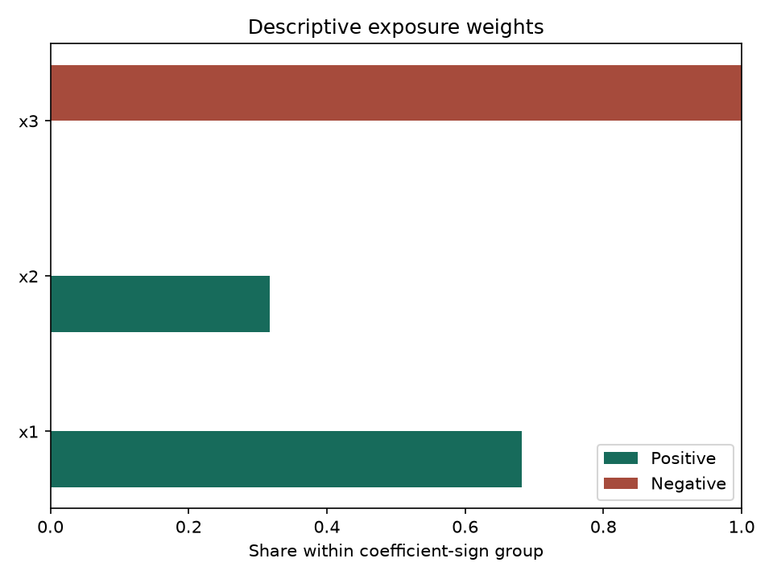
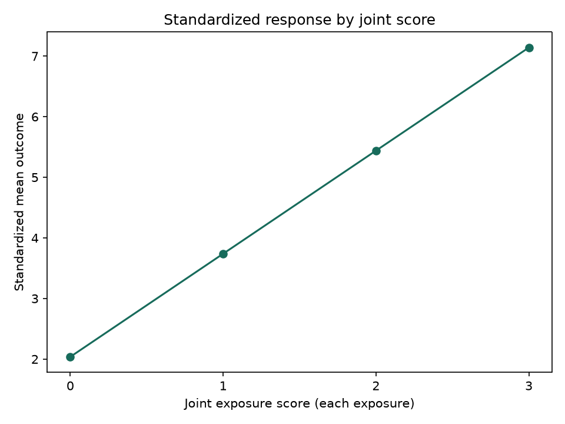

# QuantileMix reference manual

|          |                                                               |
|:---------|:--------------------------------------------------------------|
| Version  | `0.1.1`                                                       |
| Author   | Nilson Chapagain                                              |
| Contact  | [`nchapagain@tamu.edu`](mailto:nchapagain@tamu.edu)           |
| Import   | `quantilemix`                                                 |
| Requires | Python 3.10 or later; NumPy 2.0 or later; SciPy 1.14 or later |
| License  | GNU General Public License, version 2 or later                |

## Description

Quantile g-computation transforms exposures into ordinal quantile scores and estimates the joint effect of increasing all exposures simultaneously by one quantile. The package supports selected models for continuous, binary, count, and survival outcomes, with more limited support for censored, multicategory, and zero-inflated outcomes. Each API entry documents the effect scale, required inputs, and methodological limitations.

Quantile cutpoints estimated during model fitting are reused for prediction. Sign-specific weights summarize fitted exposure coefficients rather than causal importance. Successful model fitting does not establish the validity of model assumptions or identify a causal effect without additional causal identification assumptions.

The methods follow Keil et al. (2020), <https://doi.org/10.1289/EHP5838>. Selected results were checked against R qgcomp 2.19.6. This unofficial Python package has not been endorsed by the original authors. Fitting and prediction do not require R.

## Citation

Chapagain, N. (2026). *QuantileMix: A Python package for quantile g-computation*.
[arXiv:2610.34368](https://arxiv.org/abs/2610.34368).

Record the package version or commit used and cite the statistical method used in
the analysis. The [citation page](https://nilson01.github.io/quantilemix/citation/)
provides BibTeX.

## Documentation source and adaptations

The reference entries follow the R manual’s Description, Usage, Arguments, Details, Value, Examples and See Also structure. Applicable wording is retained from the GPL-licensed R qgcomp 2.19.6 documentation. Python signatures, containers, restrictions and examples describe this package’s behavior. The adapted source and license are identified in [NOTICE.md](https://github.com/nilson01/quantilemix/blob/main/NOTICE.md).

## License and credit

Copyright in the adapted R documentation belongs to its original contributors, including Alexander Keil. The Python manual and adaptations are distributed under GPL-2.0-or-later. See [LICENSE](https://github.com/nilson01/quantilemix/blob/main/LICENSE) for the full license terms and warranty disclaimer, and [NOTICE.md](https://github.com/nilson01/quantilemix/blob/main/NOTICE.md) for attribution. DeepMix is acknowledged as prior partial Python coverage; no DeepMix code was copied.

## Using the package

### Install and run a Gaussian fit

Install from PyPI:

``` bash
pip install quantilemix
```

Or install the latest source from GitHub with Git installed:

``` bash
python -m pip install "git+https://github.com/nilson01/quantilemix.git@main"
```

Or, if you have downloaded the source, run this from the folder containing `pyproject.toml`:

``` bash
python -m pip install .
```

In this example, the first two columns are exposure scores and the third column is a continuous outcome:

``` python
import numpy as np
from quantilemix import fit

data = np.array([
    [0, 0, 1.0], [0, 1, 0.6],
    [1, 0, 2.1], [1, 1, 1.4],
    [2, 0, 3.0], [2, 1, 2.7],
    [3, 0, 4.2], [3, 1, 3.5],
])
result = fit(data[:, 2], data[:, :2], q=None)
print(result.summary())
```

Here `q=None` means the exposure columns already contain scores. Use `quantilemix` for installation and imports. For a separate Python environment, see the [Python Packaging User Guide](https://packaging.python.org/en/latest/guides/installing-using-pip-and-virtual-environments/). Contributor setup and tests are in [CONTRIBUTING.md](https://github.com/nilson01/quantilemix/blob/main/CONTRIBUTING.md).

<a id="sec:method"></a>

### Method and interpretation

Keil et al. use $X_{ji}^{q}$ for the score of exposure $j$ in person $i$, $Y_i$ for the outcome, $\beta_j$ for an exposure coefficient, and $\psi$ for the joint effect in their quantile g-computation section. We use those symbols here. We write $X_i^q$ for the vector of person $i$’s exposure scores and $Z_{i\ell}$ for adjustment covariate $\ell$, which the paper omits from its displayed additive equation. There are $n$ observations, $d$ exposures and $c$ covariates. The fitted model has $k=1+d+c$ coefficients and conditional mean

$$
E(Y_i\mid X_i^q,Z_i)=\beta_0+\sum_{j=1}^{d}\beta_j X_{ji}^{q}
                         +\sum_{\ell=1}^{c}\gamma_\ell Z_{i\ell}.
$$

 The joint effect is $\psi=\sum_{j=1}^{d}\beta_j$; its estimate is $\widehat\psi=\sum_{j=1}^{d}\widehat\beta_j$. Holding covariates fixed, the difference between two fitted means whose exposure scores all differ by one is

$$
\widehat m(X_i^q+\mathbf{1},Z_i)-\widehat m(X_i^q,Z_i)
 =\sum_{j=1}^{d}\widehat\beta_j\{(X_{ji}^{q}+1)-X_{ji}^{q}\}
 =\sum_{j=1}^{d}\widehat\beta_j=\widehat\psi.
$$

 Here $\mathbf{1}$ is a vector of $d$ ones and $\widehat m$ is the fitted conditional mean. Both exposure profiles must be meaningful for the intended interpretation. The contrast in $\widehat\psi$ raises each exposure by one score category, not by one unit of its original measurement. It does not describe an intervention that keeps scores at the top category when they would otherwise rise above it.

In this manual, a hat marks an estimated quantity. Each other method entry defines its own $\psi$ and states its scale. For example, the Gaussian $\psi$ is a mean difference, while the additive binary $\psi$ is a log odds ratio. The two values have different meanings even when the software calls both of them `psi`. For a common exposure score $a$, this manual uses $\widehat\mu(a)$ for a Gaussian standardized mean, $\widehat R(a)$ for a binary risk, and $\widehat M(a)$ for a Poisson count mean. Each entry defines its own intervention and adjustment rule. Symbols for methods beyond the paper’s examples are defined in their individual entries.

#### Confidence interval and p-value for the Gaussian effect

For the variance calculation, let $\widehat\theta$ collect the fitted intercept, exposure coefficients and covariate coefficients, in that order. This vector notation is only for the calculation; the paper names exposure coefficients separately. The contrast vector $a$ is zero for the intercept and covariates and one for each exposure. With full design matrix $D$ and residuals $e_i$, the ordinary least-squares covariance is

$$
\begin{aligned}
 \widehat\sigma^2 &= \frac{\sum_{i=1}^{n}e_i^2}{n-k}, &
 \widehat V &= \widehat\sigma^2(D^{\mathsf T}D)^{-1},\\
 \widehat{\mathrm{Var}}(\widehat\psi)&=a^{\mathsf T}\widehat V a
 =\sum_j\widehat{\mathrm{Var}}(\widehat\beta_j)
  +2\sum_{j<l}\widehat{\mathrm{Cov}}(\widehat\beta_j,\widehat\beta_l).
\end{aligned}
$$

 The software uses singular-value decomposition, a matrix method, to fit the regression and calculate $\widehat{\mathrm{Var}}(\widehat\psi)$ without directly forming the inverse shown above. The covariance terms account for the fact that the exposure coefficient estimates can vary together.

The standard error is $s=\sqrt{\widehat{\mathrm{Var}}(\widehat\psi)}$. For significance level $\alpha$, R qgcomp 2.19.6’s Gaussian convention uses

$$
\mathrm{CI}=\widehat\psi\ \pm\ z_{1-\alpha/2}s,\qquad
 p=2\,\Pr\{T_{n-1-d}\geq |\widehat\psi/s|\}.
$$

 Here $z_{1-\alpha/2}$ is a standard-normal quantile and $T_\nu$ has a Student $t$ distribution with $\nu$ degrees of freedom. The p-value uses $n-1-d$, whereas residual variance uses $n-1-d-c$. Thus the interval and test need not agree at a decision threshold. The interval is not an exact finite-sample $t$ interval. If the variation is too small to separate from numerical rounding, the software warns that the test result is undefined. The result entry explains this case.

#### Positive case weights

Case weights give observations different influence in the Gaussian regression. They differ from the descriptive sign weights below. For strictly positive weights $w_i$, the fitted coefficients minimize $\sum_i w_i(Y_i-D_i\theta)^2$. Let $W$ be the diagonal matrix of these weights and $S$ the weighted residual sum of squares. Then

$$
\widehat\sigma_w^2=\frac{S}{n-k},\qquad
 \widehat V_w=\widehat\sigma_w^2(D^{\mathsf T}WD)^{-1}.
$$

 The same joint contrast uses $a^{\mathsf T}\widehat V_w a$. R qgcomp computes exposure cutpoints before fitting, so case weights do not change them. These model-based limits do not account for complex survey sampling or correlation among observations in the same cluster. The study of 24,000 datasets used equal weights and does not show how often weighted intervals cover the true effect.

For Bernoulli-logit and Poisson-log fits, these are GLM prior weights. Each positive weight multiplies its row’s log likelihood and Fisher information. For integer weights, the coefficients and model-based covariance agree with repeating that row. Formula fits may use `missing="drop"` to omit rows with missing weights; the returned result saves the retained row positions. Weighted fixed-case agreement does not establish repeated-sample coverage.

#### Sign weights

Following the paper’s $w_j$ notation, the fitted sign weight is

$$
\widehat w_j=
\begin{cases}
\displaystyle\frac{\widehat\beta_j}
 {\sum_{\ell:\widehat\beta_\ell>0}\widehat\beta_\ell},
 & \widehat\beta_j>0,\\[8pt]
\displaystyle\frac{|\widehat\beta_j|}
 {\sum_{\ell:\widehat\beta_\ell<0}|\widehat\beta_\ell|},
 & \widehat\beta_j<0.
\end{cases}
$$

 A zero coefficient has no sign weight. The positive weights sum to one, and the negative weights separately sum to one, when those groups are present. They describe the fitted coefficients; no confidence intervals are reported for these weights. Opposite signs can cancel in $\widehat\psi$ even when individual coefficients are large. Weights are not probabilities of selection or evidence of causal importance.

#### Example plots: sign weights and fitted means

The two plots use constructed data with three exposure scores. The left plot shows descriptive sign weights. The right plot shows $\widehat\mu(a)$, the standardized fitted mean when all three exposure scores are set to level $a$. This example does not show how often confidence intervals cover the true effect across repeated datasets.





Constructed example. Left: sign weights from a conditional Gaussian fit. `x1` and `x2` share the positive group; `x3` alone fills the negative group. The groups have separate denominators, so their bar lengths do not compare causal importance. Right: standardized means from a separate additive Gaussian row-bootstrap fit. Each point gives $\widehat\mu(a)$ at the shown score $a$. The line joins fitted means; it is not an uncertainty band. Twelve seeded resamples make the example repeatable but do not assess interval coverage.

#### Quadratic Gaussian response to joint exposure changes

The conditional model includes every exposure score and its square:

$$
E(Y_i\mid X_i^q,Z_i)=\beta_0+\sum_{j=1}^d\beta_jX_{ji}^{q}
                    +\sum_{j=1}^d\beta_{j+d}(X_{ji}^{q})^{2}
                    +\gamma^{\mathsf T}Z_i.
$$

 Set every exposure score to the same level $a$, retain each row’s adjustment values, and average the fitted means. The paper calls the linear and quadratic mixture coefficients $\psi_1$ and $\psi_2$. In the restricted model, $\widehat\psi_1=\sum_j\widehat\beta_j$ and $\widehat\psi_2=\sum_j\widehat\beta_{j+d}$. When requested, the model also includes pairwise products $\beta_{j,k}X_{ji}^qX_{ki}^q$ for $j<k$, following the paper’s example $\beta_{1,2}$. Exposure-covariate products are a package extension; we write them as $\eta_{j\ell}X_{ji}^qZ_{i\ell}$. Then $\widehat\psi_2$ also includes $\sum_{j<k}\widehat\beta_{j,k}$, while $\widehat\psi_1$ also includes $\sum_{j,\ell}\widehat\eta_{j\ell}\overline Z_\ell$, where $\overline Z_\ell$ is the sample mean of covariate $\ell$. Each bootstrap draw uses its own sampled covariate mean. The fitted mean change from $a$ to $a+1$ is $\widehat\psi_1+(2a+1)\widehat\psi_2$, so it depends on the starting level. The API’s `effect_at(a)` evaluates this change.

Exposure cutpoints are fixed before row-bootstrap resampling. The covariance of the two saved resampled coefficients gives their uncertainty; normal-based confidence limits and Student $t$ p-values follow the restricted R qgcomp 2.19.6 degree-two convention. Two fixed installed-R comparisons verify the software calculation, not repeated-sample interval coverage. Separate fixed R cases also verify pairwise and exposure-covariate products. This method does not include clusters, case weights or other outcomes.

The separate `fit_quadratic_gaussian_ee` uses the same intervention curve for repeated observations with known cluster IDs. Its robust covariance sums both conditional and marginal scores within each cluster. Positive case weights enter those scores but leave exposure cuts unweighted. The fitted curve agrees with three fixed installed-R cases. For nonlinear formulas, R qgcomp 2.19.6 forms cluster scores from a saved model frame: after it changes exposure columns, squared and interaction columns can retain their original values. Python rebuilds these terms at each intervention. A separate fresh-design R calculation agrees with Python’s covariance, while the installed R interval can differ. These fixed checks do not establish repeated-dataset interval coverage.

#### Assumptions and limits

The covariance calculation assumes independent observations and the same conditional error variance for each observation. Exact small-sample calculations also require a correct normal-error model and enough independent model columns to estimate every coefficient. A successful fit does not verify these assumptions. The Gaussian validation study uses known scores from fixed population cutpoints. It does not show how intervals behave when cutpoints are estimated from each dataset.

A causal interpretation additionally needs a well-defined intervention, consistency between observed and intervention outcomes, adequate joint exposure support for the exposure combinations being compared, no effect of one person’s exposure on another person’s outcome, and sufficient control of confounding. These conditions depend on the study design and subject knowledge; software diagnostics cannot establish them. The API entries describe the supported nonlinear, interaction, clustered and resampling methods. The [coverage map](https://github.com/nilson01/quantilemix/blob/main/docs/r-api-parity.md) lists other methods and limits.

## API reference

In a Python function signature, an argument without a default is required; one with a default may be omitted. After `*`, supply arguments by name. The examples show valid calls, not full signatures. Each entry lists its other settings.

### Exposure scores and inputs

<a id="api:quantize"></a>

#### `quantize`: Assign scores to exposures

##### Description

Assign each exposure an ordered score. The function can calculate group boundaries from the data, use boundaries you supply, or accept scores you have already assigned. It saves the scores and, when boundaries are used, saves them so new observations can be scored in the same way.

##### Usage

``` python
from quantilemix import quantize

quantization = quantize(exposures)
```

##### Arguments

| Argument | Meaning and accepted inputs |
|:---|:---|
| `exposures` | Nonempty real, finite array of shape `(n, d)`, or a vector for one exposure. No missing or actively masked entries. Labels, when provided, must be unique. |
| `q` | Default `4`. Requested automatic group count: an integer from 2 to 100,000, excluding booleans. Ties may reduce the fitted count. `None` with no breaks means that inputs are already nonnegative integer-valued scores below $2^{53}$. |
| `breaks` | Default `None`. One finite, strictly increasing vector per exposure, including both outer endpoints; lengths may differ. A single vector is accepted for one exposure. Supplied breaks take priority over `q`. This is an alternative to using `q` to define cutpoints. |

##### Details

With automatic grouping, a continuous exposure is represented by scores $0,\ldots,q-1$, subject to reductions caused by ties. For example, score 1 identifies observations in the second fitted category. These are ordered numeric scores, not a matrix of separate binary indicators.

Automatic mode uses type-7 empirical quantiles, removes duplicate values from the full quantile sequence, and replaces its outer endpoints by $-10^{64}$ and $10^{64}$. A value exactly on an interior cut belongs to the lower category. The outer endpoints are included. Automatic training magnitudes must be strictly smaller than $10^{64}$. Constant exposures are rejected in automatic mode; ties can otherwise reduce the result to one category, which cannot identify a regression coefficient.

Explicit mode keeps the supplied endpoints. Values outside those endpoints raise an error; the endpoints are not automatically expanded. Prequantized mode retains the supplied scores and stores no cutpoints. Scores need not be consecutive. This mode is narrower than R’s general untransformed `q=NULL` input mode.

The `mode` field is `"quantile"`, `"explicit"` or `"prequantized"`. The stored `q` is the requested integer only in automatic mode. It is `None` in both other modes, even when a `q` value was supplied with explicit breaks. The upper bound of 100,000 automatic groups limits allocation in this implementation; it is not a restriction of the statistical method.

##### Errors.

`ValueError` is raised for invalid numeric inputs, masks, shapes, labels, group counts or cut vectors; observations outside supplied endpoints; invalid prequantized scores; automatic constant exposures; or automatic training magnitudes at least $10^{64}$. The function does not fit a model, check regression rank, or emit `QGCompWarning`.

##### Value

A `QuantizationResult` containing read-only scores, saved boundaries, category counts, feature names, training ranges and diagnostics. Its `transform` method applies the saved map to new observations.

##### Examples

``` python
from quantilemix import quantize

tied = quantize([0, 0, 0, 1], q=4)
print(tied.scores.ravel())       # [0. 0. 0. 1.]
print(tied.category_counts)      # (2,)
print(tied.diagnostics["reduced_category_columns"])  # ('x1',)

explicit = quantize([0, 1, 1.5, 2, 3], breaks=[0, 1.5, 3])
print(explicit.scores.ravel())   # [0. 0. 0. 1. 1.]
print(explicit.mode, explicit.q) # explicit None
```

In the first example, ties reduce four requested groups to two. In the second, the exact boundary value 1.5 belongs to the lower category.

##### See Also

[`QuantizationResult`](#api:quantization), [`QuantizationResult.transform`](#api:quantization-transform), [`fit`](#api:fit).

##### Source note.

The title, category-score explanation and alternative-cutpoint wording are retained or adapted from Alexander Keil’s R qgcomp 2.19.6 `man/quantize.Rd`, printed manual pages 76–77, GPL (version 2 or later). The Python array interface, complete boundary vectors, mode restrictions and result object replace the R data-frame and column-selection interface.

<a id="api:quantization"></a>

#### `QuantizationResult`: Exposure scores and their saved transformation

##### Description

The object returned by `quantize` and either `transform` method. It stores scores, the original exposure map, and diagnostics for the rows represented by those scores.

##### Usage

``` python
quantization = quantize(exposures, q=4)
quantization.scores
quantization.breaks
quantization.transform(new_exposures)
```

##### Arguments

Obtain the object from `quantize` or `transform`. The generated dataclass constructor requires internal label state and does not validate manually supplied fields.

##### Details

Results made by `quantize` or `transform` cannot be changed in place: their stored arrays and mappings are read-only. A transformed result retains the original map’s boundaries, training ranges and fitted category counts. Its scores and diagnostics describe the new rows. It does not replace the training map.

The saved category count can differ from the number of categories present in new data. When boundaries are available, the saved count includes categories that no new observation occupies. With previously assigned scores, no full list of possible categories was supplied. The saved count is then the number of distinct training scores, which need not equal the largest score plus one.

##### Value

Nine public fields are available:

| Field | Meaning |
|:---|:---|
| `scores` | Read-only float array `(n, d)` or `(m, d)`; integer-valued exposure scores for the represented rows. |
| `breaks` | Tuple of read-only boundary vectors, including outer endpoints; `None` in prequantized mode. |
| `category_counts` | Tuple of fitted bin counts, or distinct training score counts when no boundaries were supplied. Preserved by transform. |
| `mode` | `"quantile"`, `"explicit"` or `"prequantized"`. |
| `q` | Requested group count in automatic mode; `None` in explicit or prequantized mode. |
| `feature_names` | Tuple of exposure names in column order. |
| `training_min` | Read-only vector `(d,)` of minima of the original training inputs, before grouping. |
| `training_max` | Read-only vector `(d,)` of corresponding training maxima. |
| `diagnostics` | Read-only mapping with the six keys below. |

The public method is `transform`. There is no `summary()` method. The underscore-prefixed label field is internal state.

##### Quantization diagnostics.

All row indices and bin numbers are zero-based. The same mapping appears under `result.diagnostics["quantization"]` for training observations.

| Key | Meaning |
|:---|:---|
| `extrapolated_rows` | Tuple of row positions having at least one exposure below its training minimum or above its training maximum. |
| `extrapolated_columns` | Tuple of names having at least one such observation. |
| `extrapolated_counts` | One count of such values per exposure. |
| `observed_category_counts` | One distinct-score count per exposure in the currently represented rows. May differ from saved `category_counts` after transformation. |
| `empty_bins` | With boundaries, one tuple of currently unoccupied fitted bin numbers per exposure. `None` in prequantized mode because the complete category domain was not specified. |
| `reduced_category_columns` | Names whose number of fitted bins is less than requested `q`. Only automatic mode can populate it. |

Initial training extrapolation counts are zero by construction. Neither these counts nor observed categories establish adequate joint exposure support or validate the regression model.

##### Examples

``` python
from quantilemix import quantize

quantization = quantize([0, 2, 8, 10], q=4)
print(quantization.scores.ravel())   # [0. 1. 2. 3.]
print(quantization.breaks[0])
# [-1.0e+64  1.5e+00  5.0e+00  8.5e+00  1.0e+64]
print(quantization.feature_names)    # ('x1',)
print(quantization.training_min)     # [0.]
print(quantization.training_max)     # [10.]
```

##### See Also

[`quantize`](#api:quantize), [`QuantizationResult.transform`](#api:quantization-transform), [`QGCompResult.transform`](#api:result-transform).

##### Source note.

R qgcomp 2.19.6 `man/quantize.Rd` describes returned quantized data and retained cutpoints. This Python class extends that organization with explicit mode, category-count, training-range and diagnostic fields. It does not reproduce the R list interface.

<a id="api:quantization-transform"></a>

#### `QuantizationResult.transform`: Score new data with saved cutpoints

##### Description

Apply existing category boundaries to new exposures without calculating new cutpoints. In prequantized mode, check and retain the new scores.

##### Usage

``` python
transformed = quantization.transform(exposures)
```

##### Arguments

`exposures`: nonempty real, finite array `(m, d)`, or a vector for one exposure. It must have the fitted column count and order. When the original inputs were labeled, names and order must match exactly, including the presence of labels.

##### Details

The original boundaries, mode, names, category counts and training ranges stay the same. Diagnostics identify new observations outside the original training ranges. Crossing a training range alone does not trigger a warning.

`ValueError` is raised for invalid data, shapes, masks or labels; an exposure count different from the fitted map; values outside saved endpoints; or invalid prequantized scores. For automatic maps, new values can enter the extreme bins beyond the training range, provided they lie within the saved $\pm10^{64}$ endpoints. No regression is fitted.

##### Value

A new `QuantizationResult`. Its `scores` and diagnostics refer to the supplied rows; its map metadata remains unchanged.

##### Examples

``` python
from quantilemix import quantize

quantization = quantize([0, 1, 2, 3], q=2)
new = quantization.transform([1.5, 2])
print(new.scores.ravel())        # [0. 1.]
print(new.category_counts)      # (2,)
```

The original cut is 1.5. The value equal to that cut belongs to the lower category; cutpoints are not recomputed from the two new observations.

##### See Also

[`quantize`](#api:quantize), [`QuantizationResult`](#api:quantization), [`QGCompResult.transform`](#api:result-transform).

#### `qgcomp`: Select an additive model from a formula

##### Usage

``` python
from quantilemix import qgcomp
result = qgcomp("y ~ x1 + x2 + z", data, ("x1", "x2"),
                family="gaussian", q=4)
binary_rr = qgcomp("y ~ x1 + x2", data, ("x1", "x2"),
                   family="binomial", B=200, seed=17)
binary_or = qgcomp("y ~ x1 + x2", data, ("x1", "x2"),
                   family="binomial", rr=False, q=2)
survival = qgcomp("Surv(time,event) ~ x1 + x2", data,
                  ("x1", "x2"), family="cox", q=4)
```

##### Arguments and routing

`formula` names an outcome, exposures and adjustment terms; `data` supplies named columns and `exposures` lists the exposure names. `C(z)` encodes a categorical adjustment column, with sorted levels and the first as reference. Gaussian and Poisson outcomes use the existing conditional additive fitters. For a binary outcome, the default `rr=True` selects a marginal risk ratio with fixed-cut row-bootstrap uncertainty. With the default `q=4`, its one-category ratio is the exponentiated slope of a degree-one log-risk marginal model. Set `rr=False` to select the conditional log odds-ratio fit. The ratio and odds ratio are different measures; switching between them changes the scientific question. R ignores `rr` for Gaussian and Poisson outcomes, and so does this dispatcher. An additive `Surv(time,event)` formula with `family="cox"` selects the conditional Cox fit. It accepts complete rows, positive case weights, exact integer cluster IDs and known log-hazard offsets; it does not select a marginal Cox bootstrap.

`q`, `breaks` and `alpha` pass to the selected fitter. `weights` and `missing="drop"` are available for the conditional fits. `B` and `seed` are available only for the binary risk-ratio route. An `exposure_time` column name gives a Poisson observation-time offset; its additive route remains conditional, as in R. The Python formula omits the R term `offset(log(time))` and instead uses `exposure_time="time"`. An explicit R-style offset term in the Python formula is rejected.

##### Limits and value

The binary marginal method requires complete numeric data without case weights and may fail on a separated or boundary bootstrap draw. Its four-level interval was assessed in four known-score conditions (4,000 datasets; see the [study report](https://github.com/nilson01/quantilemix/blob/main/validation/RISK_RATIO_Q4_CALIBRATION_RESULTS.md)). Formulas with nonlinear terms or zero-inflated outcomes, and other unsupported formulas, raise an error. The function returns the unchanged result type of the selected fitter. Six original routes and two four-level binary cases agree with isolated installed R qgcomp 2.19.6. The dispatch and four-level comparison reports give the saved values and limits.

#### `simdata_quantized`: Generate example data with exposure scores

##### Usage

``` python
sample = simdata_quantized("survival", n=100, coef=[0.2, -0.1],
                           q=4, scale0=5, seed=17)
```

##### Arguments and Value

`outcometype` is `"continuous"`, `"logistic"`, `"survival"` or `"multinomial"`. `coef` has one entry per exposure, except multinomial outcomes, where it has one column per nonreference outcome category. `corr` controls how often later exposures copy the first exposure’s score, or its reverse order for a negative value. It does not set an exact Pearson correlation. `n`, `q`, `b0`, `yscale`, `shape0`, `scale0` and `censtime` control sample size, exposure levels and outcome generation. `seed` uses a local NumPy generator. The read-only `QuantizedSimulation` mapping contains `x1`, `x2`, and an outcome `y`, or survival `time` and event indicator `d`. Its `truecoefs` property holds known generation coefficients separately. `to_dict()` returns editable column copies. It can be passed as named `data` to formula fitters. When `ncheck=True`, Python increases `n` to the next multiple of `q`; R 2.19.6 adds the remainder instead. Python also uses the supplied survival `scale0`, which that R version does not forward. Identical numeric seeds do not give identical Python and R draws.

#### `impute_leftcenslognorm`: Left-censored lognormal imputation

##### Usage

``` python
values = impute_leftcenslognorm(y, ry, x, lod=1.0, seed=17)
```

##### Arguments and Value

`ry` marks observed positive values in `y`; `wy` defaults to their complement and selects the censored rows to impute. `x` is a complete numeric predictor matrix without an intercept. `lod` is a positive scalar or one limit per row; if omitted, the smallest observed value is used. The function fits a lognormal model using observed values and the fact that censored values lie below their limits. It draws model parameters using a normal approximation based on the fitted information matrix, then draws each replacement value below its limit. It returns positive imputed values in selected-row order. `impute_tobit` is the same function, not another algorithm. This is a Python helper for an external imputation workflow, not an R `mice` callback or a pooling method. Fixed input checks pass; installed-R agreement and repeated-imputation calibration remain open.

### Gaussian models and results

<a id="api:fit"></a>

#### `fit`: Additive Gaussian quantile g-computation

##### Description

With automatic quantile grouping, the following description from R qgcomp applies:

> This function estimates a linear dose-response parameter representing a one quantile increase in a set of exposures of interest. This function is limited to linear and additive effects of individual components of the exposure.

The Python function fits a continuous outcome using an intercept, exposure scores and optional numeric adjustment covariates. It returns $\widehat\psi=\sum_j\widehat\beta_j$, the sum of fitted exposure coefficients, and its model-based uncertainty. For supplied boundaries or prequantized scores, $\widehat\psi$ is the fitted mean change when every exposure score increases by one category.

##### Usage

``` python
from quantilemix import fit

result = fit(y, exposures)
```

##### Arguments

Let $n$ be the number of observations, $d\geq1$ the number of exposures, and $c$ the number of adjustment covariates.

| Argument | Meaning and accepted inputs |
|:---|:---|
| `y` | Nonempty real, finite outcome vector of shape `(n,)`. A column matrix of shape `(n, 1)` is rejected. |
| `exposures` | Real, finite exposure array of shape `(n, d)`. A vector of shape `(n,)` represents one exposure. All selected columns contribute to $\widehat\psi$. |
| `covariates` | `None` by default, or a real, finite array of shape `(n, c)`; a vector represents one covariate. These coefficients adjust the model but do not enter the joint sum. For this array entry point, encode categorical covariates in advance; `fit_formula` handles complete text categories. Do not supply an intercept column. Use `None`, rather than an empty-column matrix, when there are no covariates. |
| `q` | Requested number of quantile groups; default `4`. In automatic mode, an integer from 2 through 100,000; booleans are invalid. With `q=None` and no breaks, inputs must already be nonnegative integer-valued scores strictly below $2^{53}$. Supplied breaks take priority. |
| `breaks` | Default `None`. When supplied, use one finite, strictly increasing vector per exposure, including both outer endpoints. Vector lengths may differ across exposures. One vector is sufficient for a single exposure. This is an alternative to using `q` to define cutpoints. |
| `alpha` | Alpha level for confidence limit calculation; default `0.05`. Must be a finite real number strictly between 0 and 1; booleans are invalid. The nominal interval coverage is $1-\alpha$. |
| `weights` | Default `None`. When supplied, use a positive, finite case-weight vector of shape `(n,)`. One value is required per training row. Weights affect the Gaussian regression, not the quantile cuts. Zero, negative, missing and masked weights are rejected. |

##### Details

Write $X_{ji}^{q}$ for exposure $j$’s score in observation $i$, and $Z_i$ for the vector of adjustment covariates. The fitted mean model is

$$
E(Y_i\mid X_i^q,Z_i)
 =\beta_0+\sum_{j=1}^{d}\beta_j X_{ji}^{q}+\gamma^\top Z_i.
$$

 Here $\beta_0$ is the intercept, $\beta_j$ is an exposure-score coefficient, and $\gamma$ contains the covariate coefficients. The joint contrast is

$$
\psi=\sum_{j=1}^{d}\beta_j.
$$

 Holding covariates fixed, increasing each exposure score by one changes the fitted mean by $\psi$, where both score profiles are meaningful. This is a category-scale contrast, not a one-unit increase in each original measurement. It does not define a policy that clips increases at the highest category.

For quantile grouping, the R documentation states:

> For continuous outcomes, under a linear model with no interaction terms, this is equivalent to g-computation of the effect of increasing every exposure by 1 quantile.

A causal interpretation also requires appropriate study assumptions, including well-defined interventions, consistency, adequate joint exposure support and no unmeasured confounding. The software does not establish these assumptions.

Let $D=[\mathbf1,X^q,Z]$ be the design matrix, with $k=1+d+c$ columns. The function requires full column rank and $n>k$. It fits ordinary least squares by default. With positive case weights $w_i$, it minimizes $\sum_i w_i(Y_i-D_i\theta)^2$. Both modes use a singular-value decomposition (SVD). If $\widehat V$ is the estimated covariance of all coefficients, and $a$ is one for exposure coefficients and zero elsewhere, then

$$
\widehat\psi=a^\top\widehat\theta,\qquad
 \widehat{\mathrm{Var}}(\widehat\psi)=a^\top\widehat V a,\qquad
 \mathrm{SE}(\widehat\psi)=\sqrt{a^\top\widehat V a},
$$

 where $\widehat\theta$ is the vector of all fitted coefficients. Thus uncertainty includes covariance between exposure coefficients. Adding their standard errors, or only their individual variances, gives a different quantity. The software uses singular-value decomposition (SVD) to reduce loss of precision when calculating the joint variance.

Residual variance uses $n-1-d-c$ degrees of freedom. The confidence interval uses a standard-normal critical value:

$$
\widehat\psi\ \mathbin{\pm}\
 z_{1-\alpha/2}\mathrm{SE}(\widehat\psi),
$$

 where $z_u$ is the standard-normal quantile at probability $u$. The two-sided p-value instead uses a Student $t$ distribution with $n-1-d$ degrees of freedom and statistic $\widehat\psi/\mathrm{SE}(\widehat\psi)$. These are the pinned R qgcomp 2.19.6 conventions. The interval and test can disagree near a significance threshold. The normal interval is not an exact finite-sample Gaussian interval. Changing `alpha` changes only the interval limits.

Model-based uncertainty assumes independent observations and constant conditional residual variance. Case weights use model-based Gaussian covariance, not a complex-survey or cluster-robust variance. The current interface does not provide bootstrap inference, penalization, imputation, nonlinear exposure effects, exposure interactions, or other outcome families.

Inputs must be complete. Missing values, active masks, infinities, complex values, strings, object arrays and ragged arrays are rejected. Rows and variables are not silently removed. Numeric inputs are converted to double precision. An input with column labels must have unique labels after their conversion to strings. All coefficient names must be distinct across the intercept, exposures and covariates. Unlabeled columns receive names `x1`, `x2`, … and `z1`, `z2`, ….

##### Errors and warnings.

Invalid inputs, invalid quantization, insufficient residual degrees of freedom, rank deficiency and nonfinite numerical results raise `ValueError`. Unsupported keyword arguments raise Python’s `TypeError`. The function emits `QGCompWarning` when the design condition number exceeds $10^8$, or when residual or contrast variation is numerically zero. In the latter case, the interval is a point and `se` is zero, but `test_statistic` and `p_value` are `NaN`. Undefined inference is not evidence of significance.

##### Value

A `QGCompResult` object containing the joint estimate `psi` and its variance `var_psi`, the fitted model coefficients and covariance, and the positive and negative within-group sign weights in `pos_weights` and `neg_weights`. It also stores residuals and the supplied case weights, confidence limits, p-value, saved exposure boundaries and diagnostics. The complete fields and properties appear in the [`QGCompResult` entry](#api:result).

##### Examples

These 16 constructed observations use two exposures already scored 0–3. The final term supplies a fixed residual orthogonal to the additive model columns; it is not an interaction term fitted by the interface.

``` python
import numpy as np
from quantilemix import fit

x1, x2 = np.meshgrid(np.arange(4), np.arange(4))
X = np.column_stack([x1.ravel(), x2.ravel()])
y = 1 + 2*X[:, 0] - 0.5*X[:, 1]
y += 0.2*(X[:, 0]-1.5)*(X[:, 1]-1.5)
result = fit(y, X, q=None)

print(f"psi = {result.psi:.6f}")
print(f"SE = {result.se:.6f}")
print(f"95% CI = ({result.ci[0]:.6f}, {result.ci[1]:.6f})")
print(f"p = {result.p_value:.6g}")
```

    psi = 1.500000
    SE = 0.087706
    95% CI = (1.328100, 1.671900)
    p = 2.70924e-10

The fitted exposure coefficients are 2 and $-0.5$, so their sum is 1.5. The standard error describes uncertainty in that sum. The p-value tests a zero joint score contrast under the stated model and reference convention. These constructed values illustrate the calculation; they are not empirical evidence about an exposure’s health effect.

A fixed check with unequal positive case weights uses eight scored rows with two correlated exposures. Exact rational arithmetic gives $\widehat\psi=833/183$ and $\widehat{\mathrm{Var}}(\widehat\psi)=198527/334890$. Use `fit(y, X, q=None, weights=w)` with one weight per row. The weights affect the fit but do not change exposure scores or represent a survey variance.

For a raw-measurement example, see [`QGCompResult.predict`](#api:predict).

##### See Also

[`quantize`](#api:quantize), [`QGCompResult`](#api:result), [`QGCompResult.predict`](#api:predict).

##### Source note.

The quoted description and continuous-outcome explanation, the `alpha` wording, and the sequence of returned quantities are retained or adapted from Alexander Keil’s R qgcomp 2.19.6 `man/qgcomp.glm.noboot.Rd`, printed manual pages 51–53, licensed GPL (version 2 or later). Python signatures, restrictions, object fields and examples describe this separate, unofficial implementation. Binary/count outcomes and other R options have not been imported into this entry’s supported scope.

<a id="api:fit-formula"></a>

#### `fit_formula`: Additive Gaussian fit from named data

##### Description

This restricted Python interface prepares a numeric design from named columns, then calls the same Gaussian `fit` estimator documented above. It supports additive main effects and text adjustment categories. It does not change the joint-effect or uncertainty formulas.

##### Usage

``` python
from quantilemix import fit_formula

result = fit_formula(
    "y ~ x1 + x2 + C(group)", data, ("x1", "x2"),
    q=4, breaks=None, alpha=0.05, weights=None,
    missing="raise"
)
new_mean = result.predict_data(new_data)
new_scores = result.transform_data(new_data)
```

##### Arguments

`formula` is a string with one outcome name, a tilde, and additive terms separated by plus signs. Names are simple letters, digits and underscores, starting with a letter or underscore. `C(name)` marks a text categorical adjustment column. `data` is a mapping or table with named, one-dimensional columns of equal length. `exposures` is a separate, nonempty sequence of numeric exposure names in the formula. The remaining numeric terms are adjustment variables. `q`, `breaks`, `alpha` and `weights` have the same meaning as in `fit`. `missing` is `"raise"` by default or `"drop"` for explicit complete-case fitting.

##### Details

For a text category, the sorted first observed level is the reference. Each later level creates one indicator column. The result saves this level order and uses it again for `predict_data`; an unseen level is an error. `transform_data` needs only exposure columns. The fitted coefficient order is intercept, exposures in the supplied exposure order, then adjustment columns in formula order. R’s factor columns use names such as `gB`; Python uses `g[T.B]` for the same value and position.

The default rejects missing values. With `missing="drop"`, the fit omits rows missing an outcome, exposure, adjustment value, category or case weight. Automatic exposure cutpoints use all observed exposure values before this omission, matching the order in R qgcomp 2.19.6. This option does not impute missing values. Infinities, categorical exposures, interactions, transformations, offsets and no-intercept formulas remain unsupported. New prediction data must be complete.

##### Value

A `QGCompResult`. Its `formula` property records the formula. The `categorical_levels` property stores the observed level order. `training_row_indices` lists retained zero-based original positions; `original_row_count` gives the number of input rows. The named-data methods use these saved columns and cutpoints.

##### Examples

``` python
from itertools import product
import numpy as np
from quantilemix import fit_formula

rows = list(product(range(4), range(4), ("A", "B", "C")))
x1 = np.array([row[0] for row in rows])
x2 = np.array([row[1] for row in rows])
group = [row[2] for row in rows]
y = (2 + 1.5*x1 - .4*x2 + .7*(np.array(group) == "B")
     - .3*(np.array(group) == "C") + .2*(x1-1.5)*(x2-1.5))
result = fit_formula("y ~ x1 + x2 + C(group)",
                     {"y": y, "x1": x1, "x2": x2, "group": group},
                     ("x1", "x2"), q=None)
assert abs(result.psi - 1.1) < 1e-12
```

The two exposure coefficients are $1.5$ and $-0.4$, so their joint one-category score contrast is $1.1$.

For explicit complete-case fitting, copy the input and mark the missing entry. The returned row positions refer to the original input order:

``` python
incomplete_y = y.astype(float).copy()
incomplete_y[0] = np.nan
incomplete = fit_formula(
    "y ~ x1 + x2 + C(group)",
    {"y": incomplete_y, "x1": x1, "x2": x2, "group": group},
    ("x1", "x2"), q=None, missing="drop"
)
assert incomplete.training_row_indices == tuple(range(1, 48))
```

##### See Also

[`fit`](#api:fit), [`QGCompResult`](#api:result).

<a id="api:fit-bootstrap"></a>

#### `fit_bootstrap`: Fixed-cut Gaussian row bootstrap

##### Description

This function estimates the mean change when every exposure score rises by one category. It keeps the group boundaries calculated from the original data, then repeatedly draws whole rows with replacement to estimate uncertainty. It supports the additive Gaussian, linear-curve case of R `qgcomp.glm.boot`.

##### Usage

``` python
from quantilemix import fit_bootstrap
result = fit_bootstrap(y, exposures, covariates=None,
                       q=4, breaks=None, alpha=0.05, B=200, seed=None,
                       weights=None)
```

##### Arguments

`y`, `exposures`, `covariates`, `q`, `breaks` and `alpha` follow the numeric-array Gaussian `fit` entry below. This entry requires complete finite inputs and an intercept. For `q=None`, pooled observed scores must have 2–9 levels. Supplied boundaries must yield the same category count for every exposure. `B` is an integer of at least two resamples. `seed` is an optional nonnegative integer below $2^{64}$; it controls a local NumPy generator. `weights` optionally supplies one strictly positive finite case weight per row. Exposure cutpoints remain unweighted. Formulas and missing-row options are not accepted by this array entry point. Use [`fit_bootstrap_formula`](#api:fit-bootstrap-formula) for a restricted named-data formula.

##### Details

For intervention level $a$, define the standardized fitted mean

$$
\widehat\mu(a)=\frac{\sum_{i=1}^n w_i\widehat E\{Y_i\mid
 X_{1i}^{q}=\cdots=X_{di}^{q}=a,Z_i\}}{\sum_{i=1}^n w_i}.
$$

 Here $n$ is the row count, $w_i>0$ is row $i$’s case weight (one if weights are omitted), $d$ is the exposure count, and $X^q$ contains exposure scores and $Z_i$ contains observation $i$’s covariates. The slope of $\widehat\mu(a)$ is the joint effect $\widehat\psi$. For this linear additive Gaussian model it equals the sum of exposure coefficients; that equality does not generally hold with nonlinear terms or interactions.

Each resample draws $n$ whole rows with replacement, keeps each selected row’s weight and refits the model using the original score boundaries. This calculation does not account for complex survey sampling or dependence within clusters. Let $s_B$ be the sample standard deviation of the $B$ fitted slopes. The interval is $\widehat\psi\pm z_{1-\alpha/2}s_B$, where $z_u$ is a standard-normal quantile. It is not a percentile interval. The two-sided test uses a Student $t$ distribution with $n-d-c-2$ degrees of freedom, where $c$ is the number of numeric adjustment columns. A failed replicate raises an error identifying its position; no replacement draw is silently substituted.

##### Value

`GaussianBootstrapResult` stores `psi`, `var_psi`, `se`, `ci`, `test_statistic`, `p_value`, `p_value_df`, `alpha`, `B`, `seed`, read-only `bootstrap_effects`, `intervention_levels` and `intervention_means`. Its `point_fit` is the original `QGCompResult`; its model-based uncertainty is separate from the bootstrap values. `summary(digits=6)` displays saved values and method limits without refitting.

##### Examples

``` python
boot = fit_bootstrap(y, exposures, q=None, B=200, seed=17)
print(boot.psi, boot.se, boot.ci)
print(boot.summary())
import numpy as np
case_weights = np.ones(len(y))
case_weights[::3] = 2.0
weighted_boot = fit_bootstrap(y, exposures, q=None,
                              weights=case_weights, B=200, seed=17)
print(weighted_boot.summary())
```

The installed-package worked example uses a smaller, fixed resample count and checks the returned values. To compare individual resamples between Python and R, both must draw the same rows in the same order. The same integer seed does not ensure that. Two unweighted and two weighted fixed installed-R cases pass. The weighted cases and optional replay command are in `validation/WEIGHTED_BOOTSTRAP_RESULTS.md`. The 24,000-dataset study covers the earlier unweighted method; weighted interval calibration remains open.

##### See Also

`fit` for model-based Gaussian uncertainty, and `docs/reference.md` for the optional installed-R comparison.

<a id="api:fit-bootstrap-formula"></a>

#### `fit_bootstrap_formula`: Gaussian row bootstrap from named data

##### Description

This function prepares data from named columns, then runs the Gaussian row-resampling method described above with the original exposure cutpoints. It supports additive numeric exposures and numeric or text-category adjustment terms. It does not change the estimator or interval method.

##### Usage

``` python
from quantilemix import fit_bootstrap_formula

result = fit_bootstrap_formula(
    "y ~ x1 + x2 + C(group)", data, ("x1", "x2"),
    q=4, breaks=None, alpha=0.05, B=200, seed=None,
    missing="raise", weights=None
)
```

##### Arguments

`formula`, `data`, `exposures` and `missing` follow the restricted [`fit_formula`](#api:fit-formula) interface. `q`, `breaks`, `alpha`, `B` and `seed` follow `fit_bootstrap`. The default requires complete rows. With `missing="drop"`, rows missing a model value or weight are removed before resampling. Automatic exposure cutpoints still use every observed exposure value before that removal. Positive case weights follow sampled rows. Interactions, transformations, offsets and imputation are not supported.

##### Value

A `GaussianBootstrapResult`. Its `point_fit` stores the formula, category levels, original row count and retained zero-based row positions. `point_fit.predict_data` uses the saved category levels and cutpoints. The returned result stores the resampling standard error and normal interval. Its `point_fit` field separately stores model-based uncertainty from the fit to the original rows.

##### Examples

``` python
boot_named = fit_bootstrap_formula(
    "y ~ x1 + x2 + C(group)",
    {"y": y, "x1": x1, "x2": x2, "group": group},
    ("x1", "x2"), q=None, B=12, seed=19
)
print(boot_named.psi, boot_named.se, boot_named.ci)
```

The installed-package example checks this route against the array fit on the same named columns and seed. A separate weight-omission check uses a manually encoded array fit. These check input preparation; the fixed installed-R comparisons test the underlying weighted and unweighted bootstrap estimator.

##### See Also

[`fit_bootstrap`](#api:fit-bootstrap) and [`fit_formula`](#api:fit-formula).

<a id="api:fit-quadratic-bootstrap"></a>

#### `fit_quadratic_bootstrap`: Quadratic Gaussian response curve

##### Description

Fit every exposure score and its square in a conditional Gaussian model. Optionally add all distinct pairwise exposure-score products and every exposure-score by numeric-covariate product. Set all scores to each joint intervention level, average fitted means over observed adjustment values, and fit a degree-two marginal response. A fixed-cut row bootstrap estimates uncertainty for both curve coefficients.

##### Usage

``` python
from quantilemix import fit_quadratic_bootstrap
result = fit_quadratic_bootstrap(
    y, exposures, covariates=None,
    q=4, breaks=None, alpha=0.05, B=200, seed=None,
    pairwise_interactions=False, covariate_interactions=False
)
print(result.psi, result.covariance)
print(result.effect_at(1))
```

##### Arguments

`y` is a complete continuous outcome. `exposures` contain complete numeric exposure columns; `covariates` are optional complete numeric adjustment columns. `q`, `breaks` and `alpha` use the same quantization and interval conventions as `fit`. At least three consecutive joint levels starting at zero are required. `B` is an integer of at least two row resamples. `seed` controls NumPy’s local random generator. Set `pairwise_interactions=True` to add every distinct exposure-score product; this requires at least two exposures. Set `covariate_interactions=True` to add every exposure-score by numeric-covariate product; this requires at least one covariate.

##### Details

The conditional model includes $X_j^q$ and $(X_j^q)^2$ for each exposure score. When requested, it also includes $X_j^qX_k^q$ for every $j<k$. Each pairwise coefficient adds to the quadratic coefficient of the joint marginal curve. Each requested exposure-covariate product adds its coefficient multiplied by the observed covariate mean to the linear coefficient. In a bootstrap replicate, the covariate mean comes from that replicate’s sampled rows. The fitted marginal mean at joint level $a$ is quadratic. Following the paper, call its linear and quadratic coefficients $\widehat\psi_1$ and $\widehat\psi_2$. The saved `psi` vector contains $(\widehat\psi_1,\widehat\psi_2)$, not one constant effect. The fitted mean difference from $a$ to $a+1$ is $\widehat\psi_1+(2a+1)\widehat\psi_2$. The method fixes exposure cuts before independently resampling rows. Bootstrap coefficients give a two-by-two covariance, normal Wald intervals and two-sided Student $t$ p-values. The reference degrees of freedom are $n-2d-h-g-c-3$, with $n$ rows, $d$ exposures and $c$ numeric adjustment columns. Here $h=d(d-1)/2$ when pairwise products are fitted, and zero otherwise; $g=dc$ when exposure-covariate products are fitted, and zero otherwise. R qgcomp 2.19.6 calls this a degree-two marginal structural model. The method does not include clusters, weights or other families.

##### Value

`QuadraticGaussianBootstrapResult` saves conditional coefficients and covariance, intervention levels and means, three marginal polynomial coefficients, `psi`, its bootstrap covariance, standard errors, intervals, statistics, p-values, reference degrees of freedom and every resampled coefficient pair. The Booleans `pairwise_interactions` and `covariate_interactions` record the fitted design. `effect_at(level)` returns the fitted one-category mean difference from that starting level. `transform` reuses saved cuts; `summary` displays the two coefficients and uncertainty. Prequantized Python inputs retain `breaks=None`, whereas R saves synthetic endpoints.

##### Examples

``` python
import numpy as np
from quantilemix import fit_quadratic_bootstrap

x = np.array([(a, b) for a in range(4) for b in range(4)] * 5)
z = np.tile([0, 1, 2, 1, 0], 16)
y = (1 + .4*x[:, 0] - .2*x[:, 1]
     + .3*x[:, 0]**2 - .1*x[:, 1]**2 + .5*z
     + .05*((7*np.arange(len(x))) % 9 - 4))
curve = fit_quadratic_bootstrap(y, x, z, q=None, B=12, seed=19)
print(curve.effect_at(1))  # fitted mean change from 1 to 2
interaction_curve = fit_quadratic_bootstrap(
    y + .12*x[:, 0]*x[:, 1], x, z, q=None, B=12, seed=23,
    pairwise_interactions=True)
print(interaction_curve.psi)  # includes the pairwise quadratic term
covariate_curve = fit_quadratic_bootstrap(
    y + .17*x[:, 0]*z - .13*x[:, 1]*z,
    x, z, q=None, B=12, seed=31, covariate_interactions=True)
print(covariate_curve.psi)  # averages products over observed z
```

Fixed checks compare both curve coefficients with an independent least-squares calculation. Two square-only, two pairwise and two exposure-covariate cases also check exact shared bootstrap row schedules. Neither check establishes repeated-sample interval coverage.

##### See Also

[`fit_bootstrap`](#api:fit-bootstrap) for the additive Gaussian degree-one case, and `docs/reference.md` for the installed-R comparison.

<a id="api:fit-gaussian-ee"></a>

#### `fit_gaussian_ee`: Clustered Gaussian estimating equations

##### Description

Estimate an additive Gaussian joint mean difference while accounting for repeated observations within identified clusters. Sum each cluster’s conditional and marginal estimating-function contributions before computing the robust covariance. This method has no small-cluster correction.

##### Usage

``` python
from quantilemix import fit_gaussian_ee
result = fit_gaussian_ee(
    y, exposures, cluster_ids, covariates=None,
    q=4, breaks=None, alpha=0.05, weights=None
)
print(result.psi, result.se, result.ci)
```

##### Arguments

`y` is a complete continuous outcome; `exposures` contain complete numeric columns. `cluster_ids` supplies one finite exact integer ID per row. At least two distinct clusters are needed. `covariates` are optional complete numeric adjustment columns. `q` and `breaks` set the saved exposure scores as in `fit`; `alpha` is the interval error level. Joint intervention scores must include at least two consecutive levels starting at zero. The conditional design must have full column rank. Optional positive `weights` multiply each row’s conditional and marginal estimating functions. They do not change the exposure cuts.

##### Details

The conditional equation fits the additive Gaussian mean described in [Method and interpretation](#sec:method). For each common exposure level $a$, the marginal equation fits a line to the standardized mean $\widehat\mu(a)$. Its one-category mean difference $\widehat\psi$ equals the sum of fitted exposure coefficients under this additive model. Cluster totals enter the sandwich covariance $A^{-1}BA^{-\top}$, where $A$ is the derivative of both estimating equations and $B$ sums cluster-score outer products. R qgcomp 2.19.6 uses a numerical derivative; Python uses the exact derivative. Weighted fits average each intervention mean using the same case weights. Confidence limits use a normal reference and the two-sided p-value uses a Student $t$ reference with $n-d-c-2$ degrees of freedom, where $n$ is the row count, $d$ the exposure count and $c$ the adjustment-column count. A small cluster count can make these approximations unreliable.

##### Value

`GaussianEEResult` saves conditional and marginal coefficients and robust covariances, the full stacked covariance, derivative bread, cluster meat, cluster IDs and count, optional case weights, intervention levels and means, joint estimate, variance, standard error, interval, test statistic, p-value and reference degrees of freedom. `transform` reuses saved exposure cuts; `summary` explains the cluster-robust quantities. Prequantized Python inputs retain `breaks=None`, whereas R saves synthetic endpoints.

##### Examples

``` python
import numpy as np
from quantilemix import fit_gaussian_ee

x = np.array([(a, b) for a in range(4) for b in range(4)] * 5)
ids = np.arange(len(x)) // 2
z = np.arange(len(x)) % 3
y = (1 + .4*x[:, 0] - .2*x[:, 1] + .3*z
     + .07*((ids*3) % 5 - 2))
clustered = fit_gaussian_ee(y, x, ids, z, q=None)
print(clustered.psi, clustered.se, clustered.cluster_count)
```

Fixed checks compare the cluster-robust contrast with an independent least-squares and cluster-score calculation. Two fixed installed-R cases check the full stacked covariance; neither check establishes interval coverage across datasets. One further weighted installed-R case and an integer-weight row-replication check cover this option; see `validation/WEIGHTED_EE_RESULTS.md`.

##### See Also

[`fit_bootstrap`](#api:fit-bootstrap) for independent-row resampling and `docs/reference.md` for the optional R comparison.

#### `fit_quadratic_gaussian_ee`: Quadratic Gaussian curve with clustered data

##### Description

Estimate a degree-two population-average Gaussian response when rows may share a cluster. This method adds each exposure score and its square to the conditional mean. It can also add every pairwise exposure product and every exposure-by-numeric-covariate product. Its uncertainty sums estimating functions within each cluster; it does not resample rows.

##### Usage

``` python
from quantilemix import fit_quadratic_gaussian_ee
result = fit_quadratic_gaussian_ee(
    y, exposures, cluster_ids, covariates=None,
    q=4, breaks=None, alpha=0.05, weights=None,
    pairwise_interactions=False,
    covariate_interactions=False
)
print(result.psi, result.covariance, result.effect_at(0))
```

##### Arguments

`y` is a complete continuous outcome. `exposures` and optional `covariates` are complete finite numeric columns. `cluster_ids` has one exact integer ID per row and at least two distinct IDs. The joint intervention levels must be three or more consecutive values starting at zero. `q` or `breaks` defines exposure scores; `q=None` accepts already scored columns. `alpha` sets the interval error level. Optional `weights` are positive case weights. They affect both estimating equations and their cluster scores, but leave exposure cuts unweighted. The interaction flags are Boolean. Exposure-covariate products require at least one numeric covariate.

##### Details

The fitted marginal mean $\widehat\mu(a)$ is quadratic in the common score $a$. The two entries of `psi` are the paper’s linear and quadratic mixture coefficients, $(\widehat\psi_1,\widehat\psi_2)$. The fitted change from level $a$ to $a+1$ is $\widehat\psi_1+(2a+1)\widehat\psi_2$; a single constant joint effect is generally not available. The sandwich covariance is $A^{-1}BA^{-\mathsf T}$, where $A$ differentiates the conditional and marginal estimating equations and $B$ sums the outer products of their cluster totals. Confidence limits use a normal reference. Two-sided tests use a Student $t$ reference with $n-p-2$ degrees of freedom; $n$ is the row count and $p$ is the number of conditional coefficients, including the intercept. No small-cluster correction or repeated-dataset coverage claim is made.

The three fixed installed-R cases agree on conditional and marginal point coefficients and intervention means. The installed R 2.19.6 cluster-meat calculation retains precomputed squared and interaction columns after changing exposure scores within a saved model frame. Python recomputes those columns. A separate fresh-design R cluster calculation agrees with Python’s covariance; R’s reported intervals can differ. The companion validation report gives the numerical results.

##### Value

`QuadraticGaussianEEResult` stores the conditional coefficients, three marginal coefficients, two joint curve coefficients, their robust covariance, standard errors, intervals, test statistics and p-values. It also saves the full stacked covariance, derivative bread, cluster meat, intervention means, scores, cuts, IDs and optional case weights. Arrays are read-only. `effect_at(level)` calculates the fitted adjacent-level change. `summary()` displays the two curve terms and their limits.

##### Examples

``` python
curve = fit_quadratic_gaussian_ee(
    y, x, ids, z, q=None, pairwise_interactions=True
)
print(curve.psi, curve.effect_at(0), curve.effect_at(2))
```

Fixed checks compare the two curve coefficients with an independent polynomial contrast. These checks do not show that the interval covers a population value at its stated rate across datasets.

##### See Also

[`fit_gaussian_ee`](#api:fit-gaussian-ee) gives an additive clustered mean. [`fit_quadratic_bootstrap`](#api:fit-quadratic-bootstrap) uses independent-row bootstrap uncertainty.

<a id="api:result"></a>

#### `QGCompResult`: Fitted model and joint exposure summaries

##### Description

The object returned by `fit`. It contains the full fitted regression, the joint exposure contrast and uncertainty, descriptive sign summaries, the saved exposure map and numerical diagnostics.

##### Usage

``` python
result = fit(y, exposures, covariates=None, q=4)
result.psi
result.ci
result.predict(new_exposures, covariates=new_covariates)
result.transform(new_exposures)
```

##### Arguments

Obtain this object from `fit`, whose arguments are documented above. The exported class has a generated dataclass constructor, but that constructor requires internal transformation state and does not validate manually supplied fields. Use `fit` to construct a consistent result.

##### Details

Factory-produced results are frozen dataclasses. Their arrays and mappings are read-only, and changes to the original input arrays do not change the stored fit. Coefficients and their full covariance are ordered as intercept, exposures, then covariates. This covariance is not the two-by-two intercept/mixture covariance returned by the R mixture-level `vcov` generic.

For positive exposure coefficients, `pos_psi` is their sum and each positive weight is its coefficient divided by that sum. For negative coefficients, `neg_psi` is their signed sum and each negative weight is its absolute coefficient divided by the absolute sum. Each nonempty group’s weights sum to one. The mappings are sorted by decreasing weight; exact ties retain exposure order. An absent group gives an empty mapping. Exactly zero coefficients are listed separately, without rounding near-zero values into that group.

These are descriptive fitted proportions. They have no confidence intervals and are not selection probabilities or causal-importance measures. The relation $\widehat\psi=\widehat\psi_++\widehat\psi_-$ holds, but weights are not divided by the net estimate, which can be close to zero.

Use `print(result.summary())` for a statistical summary table and diagnostic explanations. The full-precision fields remain available directly. Printing the object itself gives a dataclass representation. There are no `plot`, `coef`, `confint`, `tidy` or `glance` methods.

##### Value

There are 27 public stored fields and two formula properties. Here $n$ is the training row count, $d$ the exposure count, $c$ the covariate count and $k=1+d+c$.

| Field | Meaning |
|:---|:---|
| `coefficients` | Read-only float array `(k,)` in intercept, exposure, covariate order. |
| `coefficient_names` | Tuple of $k$ names in that order. |
| `covariance` | Read-only float array `(k, k)`; covariance of all coefficient estimates in the same order. |
| `exposure_names` | Tuple of $d$ exposure names. |
| `covariate_names` | Tuple of $c$ covariate names; empty when absent. |
| `fitted_values` | Read-only float array `(n,)` of fitted training conditional means. |
| `residuals` | Read-only float array `(n,)` of outcome minus fitted mean, computed before restoring the outcome mean for numerical accuracy. |
| `case_weights` | Read-only float array `(n,)` when positive case weights were supplied; otherwise `None`. These are not descriptive sign weights. |
| `residual_df` | Integer $n-1-d-c$, used for residual variance. |
| `residual_variance` | Estimated residual variance, normally residual sum of squares divided by `residual_df`; zero when residual variation is numerically zero. |
| `psi` | Float; sum of exposure coefficients. |
| `var_psi` | Float; estimated variance of that sum, including exposure covariance terms. |
| `se` | Float; square root of `var_psi`. |
| `ci` | Tuple `(lower, upper)`; normal reference interval at nominal level $1-\alpha$. |
| `alpha` | Float significance level used for the interval. |
| `test_statistic` | Float `psi / se`; `NaN` when inference is degenerate. |
| `p_value` | Two-sided Student $t$ reference p-value; `NaN` when inference is degenerate. |
| `p_value_df` | Integer $n-1-d$, as in the pinned R convention. |
| `pos_psi` | Sum of strictly positive exposure coefficients; zero if none. |
| `neg_psi` | Signed sum of strictly negative exposure coefficients; zero if none. |
| `pos_weights` | Read-only mapping of positive exposure names to within-positive-group proportions; empty if absent. |
| `neg_weights` | Read-only mapping of negative exposure names to within-negative-group proportions; empty if absent. |
| `zero_exposures` | Tuple of exposure names with exactly zero fitted coefficients. |
| `diagnostics` | Read-only mapping with the 13 keys described below. |
| `library_versions` | Read-only mapping containing the keys `"numpy"` and `"scipy"` and their version strings. It does not contain the Python or package version. |
| `reference_version` | String `"2.19.6"`. |
| `inference` | String `"qgcomp_2.19.6"`. |

Eight properties provide convenient access to existing stored quantities:

| Property | Meaning |
|:---|:---|
| `intercept` | Float equal to `coefficients[0]`. |
| `beta_exposures` | Read-only exposure coefficient slice `(d,)`. |
| `beta_covariates` | Read-only covariate coefficient slice `(c,)`; empty when absent. |
| `breaks` | Tuple of saved boundary vectors, or `None` in prequantized mode. |
| `category_counts` | Tuple of fitted bin counts, or distinct training score counts in prequantized mode. |
| `quantization_mode` | `"quantile"`, `"explicit"` or `"prequantized"`. |
| `q` | Requested integer only in automatic mode; `None` in explicit and prequantized modes. |
| `scores` | Read-only training-score array `(n, d)`. |
| `formula` | Restricted formula string for a `fit_formula` result; otherwise `None`. |
| `categorical_levels` | Read-only mapping from adjustment category name to the saved ordered text levels; empty for an array fit. |
| `training_row_indices` | Retained zero-based input-row positions for a formula fit; `None` for an array fit. |
| `original_row_count` | Input-row count before formula row omission; `None` for an array fit. |

The public methods are `summary`, `predict`, `transform`, `predict_data` and `transform_data`. Underscore-prefixed fields hold internal state.

##### Fit diagnostics.

The mapping `result.diagnostics` contains:

| Key | Meaning |
|:---|:---|
| `rank` | Numerical design rank; $k$ in accepted fits. |
| `rank_tolerance` | Rank threshold: $\max(n,k)\,\epsilon\,s_{\max}$, where $\epsilon$ is double-precision machine epsilon and $s_{\max}$ is the largest design singular value. |
| `condition_number` | Largest divided by smallest design singular value; a measure of numerical sensitivity that depends on column scaling. |
| `condition_warning_threshold` | $10^8$; an implementation warning threshold, not a general scientific validity cutoff. |
| `ill_conditioned` | Whether the condition number is strictly above that threshold. |
| `inference_degenerate` | Whether residual or contrast variation is numerically zero and the test is undefined. |
| `residual_roundoff_tolerance` | Threshold used to identify numerical-zero residual variation on the centered outcome scale. |
| `variance_roundoff_bound` | $100\epsilon$ times the sum of absolute entries of the exposure covariance block; a numerical roundoff scale. |
| `variance_clamped` | Always `False` in this implementation; the reported joint variance is not produced by clipping a negative value. |
| `contrast_variance_method` | String `"svd_factor"`. |
| `case_weighted` | Whether positive case weights were supplied to the Gaussian regression. |
| `covariance_contrast_variance` | Literal exposure-sum contraction of the covariance matrix; numerical cancellation can make it differ from the more stable `var_psi`. |
| `quantization` | The six training quantization diagnostics listed in the [`QuantizationResult` entry](#api:quantization). |

These numerical checks do not verify the additive mean model, independent observations, constant residual variance, joint exposure support or causal identification. For new-row quantization diagnostics, call `result.transform(new_exposures)`.

##### Examples

Using `result` from the [`fit` example](#api:fit):

``` python
print(result.coefficient_names)
print(result.coefficients.round(6))
print(dict(result.pos_weights))
print(dict(result.neg_weights))
print(round(result.pos_psi, 6), round(result.neg_psi, 6))
print(result.diagnostics["inference_degenerate"])
```

    ('(Intercept)', 'x1', 'x2')
    [ 1.   2.  -0.5]
    {'x1': 1.0}
    {'x2': 1.0}
    2.0 -0.5
    False

Each sign group has one exposure, so each within-group weight is one. The partial sums show that their contributions differ in size.

##### See Also

[`fit`](#api:fit), [`QGCompResult.predict`](#api:predict), [`QGCompResult.transform`](#api:result-transform), [`QGCompWarning`](#api:warning).

##### Source note.

The ordering of joint-effect, variance, fit and sign-weight information follows the Value section of R qgcomp 2.19.6 `man/qgcomp.glm.noboot.Rd`. The class, public field names, immutability, properties and diagnostics are Python interface documentation. No R list or S3 class compatibility is implied.

#### `QGCompResult.summary`: Display a saved Gaussian fit

##### Description

Return readable text containing $\widehat\psi$, its uncertainty, descriptive sign weights, coefficient estimates and diagnostic explanations. The method uses the saved result without fitting another model or changing any value.

##### Usage

``` python
result.summary(*, digits=6)
print(result.summary())
```

##### Arguments

`digits` is the number of significant digits used for displayed estimates, uncertainty and weights. It must be an integer from 1 through 17, inclusive. Boolean values are rejected. An invalid value raises `ValueError`.

##### Details

The joint-effect row contains `psi`, standard error (SE), lower and upper confidence limits (CI), the stored $t$ statistic and its two-sided $p$-value. The display states the fitted `alpha` and reference degrees of freedom. Normal confidence limits and the reference $t$ test can give different decisions near a significance threshold; neither is recalculated by the summary.

The opening lines say whether case weights were supplied. These change the fit and differ from the descriptive sign weights below. Positive and negative sign weights are shown separately, in stored decreasing order. The corresponding signed coefficient sums are also shown. These proportions are descriptive and do not have uncertainty estimates. The full-model coefficient table contains estimates only, in the fitted order; it does not add inference for the intercept or individual exposures.

Scientific notation preserves small nonzero values, including very small $p$-values. R’s subtraction-based tail calculation can round such values to zero; Python retains its existing stable tail calculation. An undefined statistic or $p$-value appears as `NA`. A degenerate-fit explanation warns that a point interval does not establish certainty. Ill-conditioning, reduced categories from ties and empty fitted bins are explained when present. These diagnostics do not test the model assumptions or establish causality.

The return value is a Python string, not R’s summary list or coefficient matrix. Full-precision attributes remain the interface for later calculations. Printed rounding can make weights sum slightly differently from one or conceal a small difference between estimates; do not parse the text for further analysis. Column labels are quoted and control characters are escaped. Long names remain complete and can make the text wider than a terminal window.

##### Value

A `str`. The method does not print to standard output or emit warnings. Use `print` to display it. The fit’s original warnings and stored diagnostics remain unchanged. Prediction warnings concern new data and are handled by `predict`; `transform` returns the corresponding row and column diagnostics.

##### Examples

Using `result` from the [`fit` example](#api:fit):

``` python
print(result.summary())
# Joint-effect row (default six significant digits):
# psi  1.5  0.0877058  1.3281  1.6719  17.1026  2.70924e-10
print(result.summary(digits=10))
```

Here the columns are estimate, SE, lower CI, upper CI, $t$ and $p$-value. The interval uses `alpha=0.05`. Each sign group contains one exposure, so both within-group weights are one.

##### See Also

`QGCompResult`, `QGCompResult.predict`, and [docs/reference.md](https://github.com/nilson01/quantilemix/blob/main/docs/reference.md) for differences from R qgcomp’s registered summary method.

<a id="api:predict"></a>

#### `QGCompResult.predict`: Predict conditional mean outcomes

##### Description

Predict mean outcomes from a fitted `QGCompResult`. Measurements are converted to scores using the cutpoints from the original fit. Prequantized fits accept scores directly.

##### Usage

``` python
result.predict(exposures, covariates=None)
```

##### Arguments

| Argument | Meaning and accepted inputs |
|:---|:---|
| `exposures` | Real, finite array `(m, d)`, with at least one row and the fitted exposure count and order. A vector means $m$ rows of one exposure. Supply `[[x1, x2]]` for one row with two exposures. |
| `covariates` | Required when the model was fitted with covariates: an array `(m, c)`, or a vector for one covariate. Must match the fitted count and order. Supplying covariates to a model fitted without them is an error. |

Here $m\geq1$ is the number of new rows; $d$ and $c$ are the fitted exposure and covariate counts.

##### Details

The prediction is $\widehat\beta_0+X_{\mathrm{new}}^q\widehat\beta+
Z_{\mathrm{new}}\widehat\gamma$, where $X_{\mathrm{new}}^q$ uses the saved map. Cutpoints are never estimated again from a new batch. If training inputs had column labels, the same labels in the same order are required; dropping those labels is rejected. Unlabeled training arrays use positional order.

Values outside observed training exposure ranges cause `QGCompWarning`, provided they remain within stored cut endpoints. Use `transform` to inspect row and column details. Values outside stored endpoints raise `ValueError`. In prequantized mode, new scores must remain nonnegative integers below $2^{53}$. The implementation does not check covariate-range extrapolation.

Invalid shapes, labels, data, missing or unexpected covariates, and nonfinite predictions raise `ValueError`. Prediction returns conditional means. It does not return standard errors, individual-outcome intervals or causal policy values. There is no `type` argument, marginal-prediction option or option to omit exposures. Training means are stored in `fitted_values`.

##### Value

A read-only NumPy float array of shape `(m,)`.

##### Examples

``` python
import numpy as np
from quantilemix import fit

raw = np.arange(8, dtype=float)
y = 1 + 2*np.repeat(np.arange(4), 2) + np.tile([-0.5, 0.5], 4)
raw_fit = fit(y, raw)  # q=4 by default
new_raw = [-1, 1.75, 1.8, 7, 9]
print(raw_fit.transform(new_raw).scores.ravel())
print(raw_fit.predict(new_raw).round(6))
```

    [0. 0. 1. 3. 3.]
    [1. 1. 3. 7. 7.]

The second call also emits `QGCompWarning`: values at rows 0 and 4 are outside the observed training range $[0,7]$. The saved boundaries are `[-1e64, 1.75, 3.5, 5.25, 1e64]`. The value 1.75 remains in the lower category; new batches do not change these boundaries.

##### See Also

[`QGCompResult.transform`](#api:result-transform), [`QGCompWarning`](#api:warning), [`QGCompResult`](#api:result).

##### Source note.

The saved-cut prediction explanation is adapted from Alexander Keil’s R qgcomp 2.19.6 `man/predict.qgcompfit.Rd`, printed manual pages 28–29, GPL (version 2 or later). Python returns Gaussian conditional means and has its own required inputs, checks and warning behavior. The R documentation’s broader outcome, bootstrap and marginal-model options are outside this interface.

<a id="api:result-transform"></a>

#### `QGCompResult.transform`: Apply the fitted exposure map

##### Description

Convert new exposures to scores using the fitted model’s saved transformation, and return the scores with quantization diagnostics.

##### Usage

``` python
transformed = result.transform(exposures)
```

##### Arguments

`exposures`: nonempty real, finite new data of shape `(m, d)`, or a vector for one exposure. The fitted exposure count and order are required. Labels must match when training inputs were labeled. No outcome or covariates are needed.

##### Details

This method delegates to the saved `QuantizationResult.transform` method. It does not fit regression coefficients or calculate new cuts. Quantile and explicit modes apply stored boundaries; prequantized mode checks and retains scores. Values beyond observed training ranges are reported in diagnostics without a warning from this method. Values outside stored endpoints, invalid scores or invalid input shapes, values and labels raise `ValueError`.

##### Value

A new `QuantizationResult` whose `scores` and diagnostics describe the new rows. Boundaries, fitted category counts, mode, names and training ranges remain those of the original fit.

##### Examples

Using `raw_fit` from the prediction example:

``` python
transformed = raw_fit.transform([-1, 1.75, 1.8, 7, 9])
print(transformed.diagnostics["extrapolated_rows"])        # (0, 4)
print(transformed.diagnostics["extrapolated_columns"])     # ('x1',)
print(transformed.diagnostics["extrapolated_counts"])      # (2,)
print(transformed.category_counts)                        # (4,)
print(transformed.diagnostics["observed_category_counts"]) # (3,)
print(transformed.diagnostics["empty_bins"])               # ((2,),)
```

Four bins were fitted. This new batch occupies three of them, with bin 2 empty. These are different counts and are kept separately.

##### See Also

[`QGCompResult.predict`](#api:predict), [`QuantizationResult.transform`](#api:quantization-transform), [`QuantizationResult`](#api:quantization).

#### `QGCompResult.predict_data and transform_data`: Named-data prediction

##### Description

These methods are available on `fit_formula` results. They read named columns and apply the saved categorical design and exposure boundaries. `predict_data` returns conditional Gaussian mean predictions. `transform_data` returns exposure scores and diagnostics; it needs no outcome or adjustment columns.

##### Usage

``` python
means = result.predict_data({"x1": [1], "x2": [2], "group": ["B"]})
scores = result.transform_data({"x1": [1], "x2": [2]})
```

##### Arguments and details

`data` is a mapping or named table. Prediction requires every fitted exposure and adjustment column with equal row counts. Text categories must use one of the fitted levels; new levels are rejected. The original formula and reference level are retained. Array-based fits do not have a formula schema and reject these methods.

##### Value

The `predict_data` method returns a read-only vector of conditional means. The `transform_data` method returns exposure scores and diagnostics in a `QuantizationResult`. Both use the existing `predict` and `transform` calculations.

##### See Also

[`fit_formula`](#api:fit-formula), [`QGCompResult`](#api:result).

### Binary outcomes

<a id="api:fit-binomial"></a>

#### `fit_binomial`: Additive binary-outcome fit

##### Description

Fit a complete Bernoulli outcome, coded 0 or 1, with an additive logit model. The estimate $\widehat\psi=\sum_j\widehat\beta_j$ is a conditional log odds ratio. Its exponent $\exp(\widehat\psi)$ is an odds ratio, not a risk ratio.

##### Usage

``` python
from quantilemix import fit_binomial

result = fit_binomial(
    y, exposures, covariates=None,
    q=4, breaks=None, alpha=0.05, weights=None
)
```

##### Arguments

`y` is a nonempty vector containing both 0 and 1. `exposures` are real, finite columns, with one row per outcome. `covariates` are optional complete numeric adjustment columns. `q`, `breaks` and `alpha` follow `fit`. Positive `weights` are optional GLM prior weights; exposure cuts do not use them.

##### Details

The fitted model is

$$
\mathrm{logit}\Pr(Y=1\mid X^q,Z)
=\beta_0+\sum_{j=1}^{d}\beta_j X_j^q+\gamma^\top Z.
$$

 The joint log odds ratio is $\psi=\sum_j\beta_j$ for one score-category increase in every exposure with adjustment values fixed. The covariance of the full coefficient vector gives the joint standard error, including cross terms. Normal critical values form the confidence interval, and a normal z statistic gives the two-sided p-value. This matches the binomial branch of R qgcomp 2.19.6; the Gaussian branch uses a different p-value rule. Predictions return conditional event probabilities using saved cuts. The fit rejects constant outcomes, rank deficiency, nonconvergence and numerical separation. Grouped trials, incomplete rows, offsets, interactions and other links are outside this entry.

##### Value

A `BinomialResult` with the joint log odds ratio, model covariance, normal interval, p-value, odds ratio and conditional predictions.

##### Examples

``` python
import numpy as np
from quantilemix import fit_binomial

cells = ((0, 0, 5), (1, 0, 10), (0, 1, 10), (1, 1, 15))
x = np.vstack([np.tile([a, b], (20, 1)) for a, b, _ in cells])
y = np.concatenate([np.r_[np.ones(s), np.zeros(20-s)]
                    for _, _, s in cells])
result = fit_binomial(y, x, q=None)
assert abs(result.psi - np.log(9)) < 1e-12
assert abs(result.odds_ratio - 9) < 1e-12
```

The four event fractions are 0.25, 0.5, 0.5 and 0.75. The joint conditional odds ratio is exactly 9 in this construction.

##### See Also

[`fit_binomial_formula`](#api:fit-binomial-formula), [`BinomialResult`](#api:binomial-result), [`fit`](#api:fit).

<a id="api:fit-binomial-formula"></a>

#### `fit_binomial_formula`: Binary fit from named data

##### Description

Prepare named columns, including optional text adjustment categories, then call the same additive Bernoulli-logit estimator.

##### Usage

``` python
from quantilemix import fit_binomial_formula

result = fit_binomial_formula(
    "y ~ x1 + x2 + C(group)", data, ("x1", "x2"),
    q=4, breaks=None, alpha=0.05, missing="raise", weights=None
)
new_probability = result.predict_data(new_data)
```

##### Arguments

`formula`, `data` and `exposures` follow the restricted main-effects grammar of `fit_formula`. The outcome must contain only 0 and 1. `q`, `breaks` and `alpha` follow `fit_binomial`. `missing="drop"` explicitly removes rows with a missing outcome, exposure or adjustment value. The default rejects them. Missing case weights are also omitted with `missing="drop"`. Positive case weights are accepted.

##### Details

`C(name)` uses the sorted first observed text level as its reference. The saved levels and cutpoints are reused for named-data prediction. An unseen category or incomplete new row is an error. The estimand remains a conditional log odds ratio; category coefficients are adjustment terms and do not enter its exposure sum. With row removal, automatic cutpoints use all observed exposure values before omitting incomplete model rows. This matches the order in the installed R reference. No imputation occurs.

##### Value

A `BinomialResult` with saved formula and category levels. `training_row_indices` contains retained zero-based original positions; `original_row_count` records the input length.

##### Examples

Use the four-cell construction above with a complete text adjustment column.

##### See Also

[`fit_binomial`](#api:fit-binomial), [`fit_formula`](#api:fit-formula).

<a id="api:fit-binomial-risk-ratio"></a>

#### `fit_binomial_risk_ratio`: Marginal binary risk ratio

##### Description

Summarize how the average event probability changes when every exposure score rises by one category, using a risk ratio. This supports selected settings of R `qgcomp.glm.boot(..., rr=TRUE)`. The separate `fit_binomial` function reports an odds ratio at fixed adjustment values, which answers a different question.

##### Usage

``` python
from quantilemix import fit_binomial_risk_ratio
result = fit_binomial_risk_ratio(
    y, exposures, covariates=None,
    q=2, breaks=None, alpha=0.05, B=200, seed=None
)
```

##### Arguments

`y` contains only zero and one. `exposures` and optional `covariates` are complete finite numeric columns. `q=2` groups exposures into two categories by default; `q=4` groups them into four. `q=None` accepts already scored consecutive levels starting at zero. Supplied boundaries define the intervention levels. `alpha` is the interval error level. `B` is at least two independent row-bootstrap draws; `seed` controls a local NumPy random generator. Case weights, formulas, missing-row options and cluster resampling are not accepted by this method.

##### Details

At intervention level $a\in\{0,\ldots,q-1\}$, replace every exposure score by $a$ while retaining each person’s adjustment covariates $Z_i$. Let $\widehat p_i(a)$ be that person’s predicted event probability from the conditional logit fit. The standardized risk is

$$
\widehat R(a)=n^{-1}\sum_{i=1}^n\widehat p_i(a).
$$

 Here $n$ is the number of rows. With two levels, the effect is $\widehat\psi=\log\{\widehat R(1)/\widehat R(0)\}$. With more levels, the effect is the slope $\widehat\psi$ from a degree-one log-binomial marginal model of all the standardized risks $\widehat R(a)$ against $a$. The reported one-category risk ratio is $\exp(\widehat\psi)$; it need not equal $\widehat R(1)/\widehat R(0)$ when there are more than two levels. Each bootstrap draw resamples whole rows, refits the conditional logit and marginal model, and saves its slope. Their sample standard deviation is the bootstrap standard error. Normal limits on the log scale are exponentiated for the risk-ratio interval. The two-sided test uses a normal $z$ statistic. A failed replicate raises an error and is never silently replaced.

##### Value

`BinomialRiskRatioResult` saves `psi` (log risk ratio), `risk_ratio`, `se`, both log-scale and ratio-scale intervals, `p_value`, and standardized `intervention_risks`. It also saves read-only marginal-model coefficients (`msm_coefficients`), fitted risks (`msm_fitted_risks`), bootstrap slopes (`bootstrap_effects`), and the conditional `point_fit`. `summary(digits=6)` displays the saved values without refitting.

##### Examples

``` python
rr = fit_binomial_risk_ratio(y, exposures, q=None, B=200, seed=17)
print(rr.risk_ratio, rr.risk_ratio_ci)
```

The two-level worked example has an independently known risk ratio of three and a conditional odds ratio of nine. A second example fits four levels. Two fixed cases at each level count agree with installed R qgcomp 2.19.6 under identical saved resampling schedules. A separate four-level study recorded 4,000 datasets and one bootstrap separation failure. See the [study report](https://github.com/nilson01/quantilemix/blob/main/validation/RISK_RATIO_Q4_CALIBRATION_RESULTS.md) for coverage and limits.

##### See Also

[`fit_binomial`](#api:fit-binomial) for conditional odds ratios.

#### `fit_binomial_odds_ratio`: Marginal binary odds ratio

##### Description

Estimate a fitted population-average odds-ratio summary across joint exposure-score levels. It follows the degree-one logistic marginal model in R `qgcomp.glm.boot(..., rr=FALSE)`. It can differ from the conditional odds ratio even without confounding, because odds ratios are not generally collapsible over adjustment variables.

##### Usage

``` python
from quantilemix import fit_binomial_odds_ratio
result = fit_binomial_odds_ratio(
    y, exposures, covariates=None,
    q=2, breaks=None, alpha=0.05, B=200, seed=None
)
```

##### Arguments

The complete numeric inputs and score controls match [`fit_binomial_risk_ratio`](#api:fit-binomial-risk-ratio). `B` is the number of independent-row bootstrap draws, at least two. `seed` controls the local generator. Case weights, formulas, missing rows and cluster resampling are not supported by this method.

##### Details

Let $\widehat R(a)$ be the mean predicted event probability when every exposure score is set to $a$, keeping observed adjustment covariates. With two levels, the effect is $\widehat\psi=\mathrm{logit}\{\widehat R(1)\}-
\mathrm{logit}\{\widehat R(0)\}$, where $\mathrm{logit}(p)=\log\{p/(1-p)\}$. With more levels, a degree-one logistic marginal model fits all $\widehat R(a)$ against $a$ with equal weight per score. The reported fitted odds-ratio summary is $\exp(\widehat\psi)$. It need not equal the marginal odds ratio between any one pair of adjacent score levels. Each fixed-cut bootstrap draw refits the conditional and marginal models. Their slope standard deviation supplies normal intervals on the log scale. A failed replicate is named and not replaced.

##### Value

`BinomialOddsRatioResult` saves the log effect `psi`, `odds_ratio`, bootstrap `se`, log and ratio confidence limits, `p_value`, standardized `intervention_risks`, marginal-model coefficients and fitted risks, bootstrap slopes, and the conditional `point_fit`. `summary(digits=6)` displays their meanings.

##### Examples

``` python
or_fit = fit_binomial_odds_ratio(y, exposures, q=None, B=200, seed=17)
print(or_fit.odds_ratio, or_fit.odds_ratio_ci)
```

The installed-wheel example checks a two-level adjusted fit. Two fixed four-level cases, one adjusted, agree with installed R qgcomp 2.19.6 under the same 24 bootstrap row sets. Independent arithmetic and seeded checks also pass. Repeated-data interval coverage remains untested.

##### See Also

[`fit_binomial_risk_ratio`](#api:fit-binomial-risk-ratio) for a marginal risk ratio, and [`fit_binomial`](#api:fit-binomial) for a conditional odds ratio.

#### `fit_binomial_ee`: Clustered binary estimating equations

##### Description

Estimate a marginal binary-outcome association for a joint increase in all exposure scores, with observations grouped by cluster. Choose a marginal risk ratio (`rr=True`) or odds ratio (`rr=False`).

##### Usage

``` python
from quantilemix import fit_binomial_ee
result = fit_binomial_ee(
    outcomes, exposures, cluster_ids, covariates=None,
    q=4, breaks=None, alpha=0.05, rr=True, weights=None
)
print(result.effect_ratio, result.se, result.ci)
```

##### Arguments

`outcomes` contains zeros and ones. `exposures` and optional `covariates` contain complete numeric rows. `cluster_ids` has one finite exact integer per row and at least two distinct values. `q` or `breaks` sets exposure scores. The resulting joint intervention levels must run consecutively from zero. `alpha` sets the interval error level. Optional positive `weights` apply to both estimating equations and cluster totals but not exposure cuts. Offsets, nonlinear terms and time-lag structure are not supported.

##### Method and interpretation

A conditional logistic model predicts each person’s event risk at every joint score. Averaging these risks across people, using case weights when supplied, gives standardized risks. The marginal model then fits a straight line to their log risks when `rr=True`, or to their log odds when `rr=False`. Its slope describes one score increase on that fitted marginal scale. With more than two scores, the exponentiated slope need not equal the ratio of two adjacent standardized risks or odds. The covariance uses both conditional and marginal estimating equations, sums their scores within clusters, and forms a sandwich estimate. The normal interval may be unreliable with few clusters. Neither fixed-case agreement nor the exact-cell check establishes interval coverage.

##### Value

`BinomialEEResult` saves conditional and marginal coefficients, robust covariances, the full stacked covariance, derivative bread, cluster meat, cluster count, optional case weights, intervention levels, standardized and marginal fitted risks, joint log effect, standard error, interval, test and p-value. `effect_ratio` and `effect_ratio_ci` exponentiate the log-scale effect and interval. `transform` reuses the fitted cuts; `summary` explains the scale and uncertainty. Four fixed installed-R cases and an independent exact-cell calculation pass; see `validation/BINOMIAL_EE_RESULTS.md`. Two additional weighted installed-R cases cover the odds and risk links; integer-weight row replication checks both sandwiches independently. See `validation/WEIGHTED_EE_RESULTS.md`.

<a id="api:binomial-result"></a>

#### `BinomialResult`: Binary model result and conditional odds contrast

##### Description

This immutable result stores a Bernoulli-logit fit and the joint exposure coefficient on the log-odds scale. It does not reuse the Gaussian residual variance or Student t diagnostics.

##### Usage

``` python
result = fit_binomial(y, exposures, q=None)
print(result.psi, result.odds_ratio)
print(result.summary())
probability = result.predict(new_exposures)
```

##### Value

| Field | Meaning |
|:---|:---|
| `coefficients`, `coefficient_names` | Read-only full-model estimates in intercept, exposure, then adjustment order. |
| `covariance` | Read-only full coefficient covariance from final Fisher information. |
| `psi`, `var_psi`, `se` | Conditional joint log odds ratio, its variance and standard error. |
| `ci`, `p_value`, `test_statistic` | Normal confidence limits, two-sided z p-value and z statistic. |
| `odds_ratio`, `odds_ratio_ci` | Exponentiated joint effect and interval; these are not risk ratios. |
| `fitted_values` | Training event probabilities. |
| `case_weights` | Read-only GLM prior weights when supplied; otherwise `None`. |
| `pos_weights`, `neg_weights` | Descriptive coefficient shares within each sign group. |
| `scores`, `breaks`, `q` | Saved exposure scores and cutpoint information. |
| `family`, `link` | The strings `"binomial"` and `"logit"`. |
| `diagnostics` | Read-only rank, condition, iteration and grouping information. |

##### Methods

`predict` returns conditional event probabilities. `transform` reuses saved exposure cuts. Formula results also support `predict_data` and `transform_data`. `summary` returns a plain-text display of the saved joint effect, interval and p-value; it never refits the model.

##### See Also

[`fit_binomial`](#api:fit-binomial), [`fit_binomial_formula`](#api:fit-binomial-formula), [`QGCompResult`](#api:result).

### Count outcomes

<a id="api:fit-poisson"></a>

#### `fit_poisson`: Additive count-outcome fit

##### Description

Fit complete nonnegative integer counts with an additive Poisson log-link model. The estimate $\widehat\psi=\sum_j\widehat\beta_j$ is a conditional log rate ratio. An optional observation-time offset accounts for unequal periods.

##### Usage

``` python
from quantilemix import fit_poisson

result = fit_poisson(
    y, exposures, covariates=None,
    q=4, breaks=None, alpha=0.05, weights=None,
    exposure_time=None
)
```

##### Arguments

`y` is a nonempty vector of nonnegative integer counts with a positive total. `exposures` are real, finite columns with one row per outcome. `covariates` are optional complete numeric adjustment columns. `q`, `breaks` and `alpha` follow `fit`. Positive `weights` act as GLM prior weights. `exposure_time` is an optional positive, finite vector with one observation period per row.

##### Details

The fitted conditional mean model is

$$
\log E(Y\mid X^q,Z,t)=\log t+\beta_0+
\sum_{j=1}^{d}\beta_jX_j^q+\gamma^\top Z,
$$

 where $t>0$ is the observation time; $t=1$ when no offset is given. The joint log rate ratio is $\psi=\sum_j\beta_j$ for a one-category increase in every exposure at the same time, holding adjustment values fixed. The full Fisher covariance includes cross terms in its joint standard error. Normal critical values form the confidence interval, and a normal z statistic gives the two-sided p-value, following the Poisson branch of R qgcomp 2.19.6. Predictions return conditional expected counts from saved cutpoints. An offset fit needs new times for prediction. It does not handle overdispersion, interactions or alternative links.

##### Value

A `PoissonResult` with the joint log rate ratio, model covariance, normal interval, p-value, exponentiated ratio and expected-count prediction.

##### Examples

``` python
import numpy as np
from quantilemix import fit_poisson

cells = ((0, 0, 1), (1, 0, 2), (0, 1, 3), (1, 1, 6))
x = np.vstack([np.tile([a, b], (10, 1)) for a, b, _ in cells])
y = np.concatenate([np.repeat(m, 10) for _, _, m in cells])
result = fit_poisson(y, x, q=None)
assert abs(result.psi - np.log(6)) < 1e-12
assert abs(result.rate_ratio - 6) < 1e-12
```

The cell means are exactly 1, 2, 3 and 6. Their joint conditional rate ratio is 6 in this construction. For unequal observation periods:

``` python
time = np.tile(np.arange(1, 6), 4)
x = np.vstack([np.tile([a, b], (5, 1)) for a, b, _ in cells])
y = np.concatenate([rate * time[:5] for _, _, rate in cells])
offset_fit = fit_poisson(y, x, q=None, exposure_time=time)
assert abs(offset_fit.rate_ratio - 6) < 1e-12
assert abs(offset_fit.predict([[1, 1]], exposure_time=[3])[0] - 18) < 1e-12
```

##### See Also

[`fit_poisson_formula`](#api:fit-poisson-formula), [`PoissonResult`](#api:poisson-result), [`fit`](#api:fit).

<a id="api:fit-poisson-formula"></a>

#### `fit_poisson_formula`: Count fit from named data

##### Description

Prepare named columns, including optional text adjustment categories, then call the additive Poisson-log estimator.

##### Usage

``` python
from quantilemix import fit_poisson_formula

result = fit_poisson_formula(
    "y ~ x1 + x2 + C(group)", data, ("x1", "x2"),
    q=4, breaks=None, alpha=0.05, missing="raise", weights=None,
    exposure_time=None
)
new_mean = result.predict_data(new_data)
```

##### Arguments

`formula`, `data` and `exposures` follow the restricted main-effects grammar of `fit_formula`. The outcome must contain only nonnegative integer counts. `missing="drop"` explicitly removes rows with a missing outcome, exposure or adjustment value. The default rejects them. Missing case weights are also omitted with `missing="drop"`. Positive case weights are accepted. Set `exposure_time="time"` to name a positive observation-time column. Missing times are omitted with `missing="drop"`; the default rejects them.

##### Details

`C(name)` uses the sorted first observed text level as its reference. The saved levels and cutpoints are reused for named-data prediction. Category coefficients adjust the model but do not enter the joint exposure sum. An unseen category or incomplete new row is an error. With row removal, automatic cutpoints use all observed exposure values before omitting incomplete model rows. The restricted formula parser does not accept inline `offset(log(time))`; pass the column name separately. This option does not impute.

##### Value

A `PoissonResult` with saved formula and category levels. `training_row_indices` contains retained zero-based original positions; `original_row_count` records the input length.

##### Examples

Use the four-cell construction above with a complete text adjustment column.

##### See Also

[`fit_poisson`](#api:fit-poisson), [`fit_formula`](#api:fit-formula).

#### `fit_poisson_bootstrap`: Marginal Poisson row bootstrap

##### Description

Estimate the ratio of average counts when every exposure score rises by one category. This supports the additive Poisson case of R `qgcomp.glm.boot`. It keeps the original exposure boundaries and resamples whole, independent rows. Unlike `fit_poisson`, it uses the variation across those resamples to estimate uncertainty.

##### Usage

``` python
from quantilemix import fit_poisson_bootstrap
result = fit_poisson_bootstrap(
    y, exposures, covariates=None,
    q=4, breaks=None, alpha=0.05, B=200, seed=None,
    exposure_time=None
)
```

##### Arguments

`y` contains nonnegative integer counts. `exposures` and optional `covariates` are complete finite numeric columns. `q` requests exposure groups; `q=None` accepts already scored consecutive levels starting at zero. Supplied boundaries must yield the same category count for each exposure. `alpha` is the interval error level, `B` is at least two row-bootstrap draws, and `seed` controls a local NumPy random generator. `exposure_time` contains one positive observation period per row when periods differ. If omitted, periods are treated as equal. Weights, formulas, missing-row options and cluster resampling are not accepted here.

##### Details

For intervention level $a$, set all exposure scores to $a$ while leaving each observed covariate row $Z_i$ and its observation time in place. If $\widehat\mu_i(a)$ is that row’s fitted count mean over its original time, the standardized mean and joint log mean ratio are

$$
\widehat M(a)=n^{-1}\sum_{i=1}^n\widehat\mu_i(a),\qquad
 \widehat\psi=\log\{\widehat M(a+1)/\widehat M(a)\}.
$$

 Here $n$ is the row count. Both intervention means use the same distribution of observation times. With an additive log link and an offset equal to the log of observation time, their one-step log ratio is constant across levels and equals the sum of conditional exposure coefficients. Thus, the count mean ratio is also a rate ratio for this model. Each bootstrap draw refits the conditional Poisson model after resampling whole rows, including their observation times. The sample standard deviation of its saved log ratios is the bootstrap standard error. Normal limits and a two-sided normal $z$ test follow R qgcomp 2.19.6’s Poisson convention. The mean-ratio interval exponentiates the log-scale limits. A failed draw raises an error.

##### Value

`PoissonBootstrapResult` stores the joint log mean ratio `psi`, `rate_ratio`, bootstrap `se`, both intervals, `p_value`, read-only `intervention_means` and `bootstrap_effects`, and the conditional `point_fit`. `summary(digits=6)` displays saved values without refitting.

##### Examples

``` python
count_boot = fit_poisson_bootstrap(y, exposures, q=None, B=200, seed=29)
print(count_boot.rate_ratio, count_boot.rate_ratio_ci)

unequal_time = fit_poisson_bootstrap(
    y, exposures, q=None, exposure_time=periods, B=200, seed=29
)
print(unequal_time.intervention_means, unequal_time.rate_ratio)
```

The equal-period installed-package example has an independently known mean ratio of six. Two equal-period and two unequal-time cases agree with isolated installed R qgcomp 2.19.6 under identical row schedules. Separate 4,000-dataset studies assess [equal-period](https://github.com/nilson01/quantilemix/blob/main/validation/POISSON_BOOTSTRAP_CALIBRATION_RESULTS.md) and [unequal-time](https://github.com/nilson01/quantilemix/blob/main/validation/POISSON_BOOTSTRAP_OFFSET_CALIBRATION_RESULTS.md) intervals.

##### See Also

[`fit_poisson`](#api:fit-poisson) for model-based uncertainty.

#### `fit_poisson_ee`: Clustered Poisson estimating equations

##### Description

Estimate the marginal log mean or rate ratio for one joint score increase, allowing repeated observations within identified clusters. The model is additive on the conditional log scale. Positive observation times can enter as a log offset.

##### Usage

``` python
from quantilemix import fit_poisson_ee
result = fit_poisson_ee(
    counts, exposures, cluster_ids, covariates=None,
    q=4, breaks=None, alpha=0.05, weights=None,
    exposure_time=None
)
print(result.mean_ratio, result.se, result.ci)
```

##### Arguments

`counts` contains nonnegative integer outcomes. `exposures` and optional `covariates` contain complete numeric rows. `cluster_ids` contains one finite exact integer ID per row and at least two distinct IDs. `q` and `breaks` determine saved exposure scores; joint intervention levels must be consecutive from zero. `alpha` is the interval error level. Optional positive `weights` apply to both estimating equations and cluster totals but not exposure cuts. `exposure_time` is a positive time vector with one value per row. The times are held fixed when the joint exposure score changes. Nonlinear terms and time-lag structure are not supported in this subset.

##### Method and interpretation

Let $t_i$ be row $i$’s observation time, or one if none is supplied. The conditional equation fits a Poisson model with log mean $\log t_i+\beta_0+\sum_j\beta_jX_{ji}^q+\gamma^\top Z_i$. For each joint score $a$, the method predicts an expected count after assigning that score to every exposure while keeping $t_i$ fixed. A marginal log-linear model describes these predictions across the common score $a$. Case weights, when supplied, enter both estimating equations. Under this additive conditional model, the fitted one-category log rate ratio $\widehat\psi$ equals the sum of fitted exposure coefficients. The cluster-robust covariance sums both estimating functions within each cluster before forming the sandwich. Python calculates the derivative exactly; R qgcomp 2.19.6 uses a numerical derivative. The normal interval and test use the cluster-robust standard error. They can be unreliable with few clusters. With unequal times, $\exp(\widehat\psi)$ is a rate ratio for the observed time distribution. This does not model time-varying effects.

##### Value

`PoissonEEResult` saves conditional and marginal coefficients, their robust covariances, the full stacked covariance, derivative bread, cluster meat, cluster count, optional case weights and observation times, fitted counts, intervention levels and means, the joint log effect, standard error, interval, test and p-value. `mean_ratio` and `rate_ratio` and `mean_ratio_ci` exponentiate the log-scale values. `transform` reuses fitted cuts; `summary` describes the uncertainty. Two fixed equal-time installed-R cases and an independent exact-cell calculation pass; see `validation/POISSON_EE_RESULTS.md`. Installed R 2.19.6 ignores its `offset` argument in this EE method. Python’s unequal-time extension instead passes an independent sandwich calculation and a fixed installed-R difference check; see `validation/POISSON_EE_OFFSET_RESULTS.md`. Repeated-data coverage, overdispersion and small-cluster behavior remain untested. One weighted installed-R case and an independent row-replication check cover case weights; see `validation/WEIGHTED_EE_RESULTS.md`.

<a id="api:poisson-result"></a>

#### `PoissonResult`: Count model result and conditional rate ratio

##### Description

This immutable result stores a Poisson-log fit and its joint exposure coefficient on the log-rate scale. It has no Gaussian residual variance or Student t diagnostics.

##### Usage

``` python
result = fit_poisson(y, exposures, q=None)
print(result.psi, result.rate_ratio)
print(result.summary())
expected_count = result.predict(new_exposures)
```

##### Value

| Field | Meaning |
|:---|:---|
| `coefficients`, `coefficient_names` | Read-only full-model estimates in intercept, exposure, then adjustment order. |
| `covariance` | Read-only full coefficient covariance from final Fisher information. |
| `psi`, `var_psi`, `se` | Conditional joint log rate ratio, its variance and standard error. |
| `ci`, `p_value`, `test_statistic` | Normal confidence limits, two-sided z p-value and z statistic. |
| `rate_ratio`, `rate_ratio_ci` | Exponentiated joint rate effect and interval at equal observation time. |
| `fitted_values` | Training expected counts. |
| `case_weights` | Read-only GLM prior weights when supplied; otherwise `None`. |
| `exposure_time` | Read-only training times when an offset was supplied; otherwise `None`. |
| `pos_weights`, `neg_weights` | Descriptive coefficient shares within each sign group. |
| `scores`, `breaks`, `q` | Saved exposure scores and cutpoint information. |
| `family`, `link` | The strings `"poisson"` and `"log"`. |
| `diagnostics` | Read-only rank, condition, iteration and grouping information. |

##### Methods

`predict` returns conditional expected counts. Offset fits require new `exposure_time` values. `transform` reuses saved exposure cuts. Formula results also support `predict_data` and `transform_data`. `summary` returns a plain-text display of the saved joint effect and inference without refitting.

##### See Also

[`fit_poisson`](#api:fit-poisson), [`fit_poisson_formula`](#api:fit-poisson-formula), [`BinomialResult`](#api:binomial-result).

### Survival, censored and multicategory outcomes

<a id="api:fit-cox"></a>

#### `fit_cox`: Conditional right-censored survival fit

##### Description

Fit a restricted Cox proportional-hazards model for observations with a follow-up time and an event indicator. The estimate $\widehat\psi=\sum_j\widehat\beta_j$ is a conditional log hazard ratio at the same adjustment values. It is not a survival probability or a marginal effect.

##### Usage

``` python
fit_cox(durations, events, exposures, covariates=None,
        *, q=4, breaks=None, alpha=0.05, weights=None,
        offset=None, cluster_ids=None)
```

##### Arguments

`durations` is a one-dimensional vector of positive follow-up times. `events` has the same length and contains 1 for an observed event or 0 for right censoring. `exposures` has one or more complete numeric columns. `covariates` contains optional complete numeric adjustment columns. `q` and `breaks` use the same exposure grouping rules as `quantize`; use `q=None` only for nonnegative integer scores. `alpha` sets the normal confidence level to $1-\alpha$. `weights` supplies one positive finite case weight per row. Case weights affect risk sets and event contributions but not exposure cutpoints. `offset` supplies one known, finite log-hazard contribution per row. It is not an observation-time offset and has no estimated coefficient. `cluster_ids` supplies one finite, exact integer ID per row, with at least two distinct IDs. Rows sharing an ID contribute together to robust uncertainty. IDs do not change the fitted hazard ratio or exposure cuts.

##### Details

For exposure scores $X_{ji}^q$ and adjustment values $Z_i$, the fitted Cox hazard is $h(t\mid X_i^q,Z_i,o_i)=
h_0(t)\exp(\sum_j\beta_jX_{ji}^q+\gamma^TZ_i+o_i)$, where $o_i$ is the optional known log offset (zero when omitted). Here $h_0(t)$ is an unspecified baseline hazard. The reported joint log hazard ratio is $\psi=\sum_j\beta_j$: every exposure score rises by one, while adjustment values stay fixed. With no weights or only integer case weights, the standard error uses the fitted partial-likelihood information matrix. Fractional case weights use a robust variance built from each row’s weighted score contribution, matching the default R `coxph` behavior. With cluster IDs, weighted row scores are first summed within each cluster; the sums form the robust covariance. No small-cluster correction is applied. Normal limits and a two-sided normal $z$ test follow the conditional R qgcomp 2.19.6 convention. When events share a follow-up time, Efron’s method approximates their order within the event group. Records censored at that time remain at risk for its events. This matches the installed R reference’s default tie method. The array method has no formula or population-average survival estimate. Its uncentered baseline cumulative hazard supports conditional survival predictions at the observed follow-up times. Independent censoring and proportional hazards are substantive assumptions; a successful fit does not establish either assumption or a causal interpretation.

##### Value

`CoxResult` stores read-only coefficients, their covariance, exposure scores and cutpoints, joint `psi`, variance, standard error, confidence limits, test statistic, p-value, event count, number of shared-time groups, maximized partial log likelihood, weighted baseline hazard and iteration count. `case_weights` stores the supplied read-only weights, or `None`. `robust_variance` indicates a fractional-weight or cluster-score sandwich. `offset` stores the supplied read-only log offsets, or `None`. `cluster_ids` stores read-only IDs, and `cluster_count` gives their count; both are `None` when omitted. `hazard_ratio` and `hazard_ratio_ci` exponentiate the log-scale values. `survival_curve(exposures, covariates=None, offset=...)` returns observed follow-up times and a matrix of conditional survival probabilities with one column per new profile. A fit that used offsets requires one offset for each new profile; it does not reuse the training offsets. It reuses saved exposure cuts; censor-only times retain the previous survival value. `summary()` displays the saved values without refitting.

##### See Also

[`quantize`](#api:quantize). The two fixed reference cases and their comparison procedure are recorded in the Cox validation report. The two additional shared-time cases are recorded in the `COX_TIES_RESULTS.md` report. Three fixed weighted cases are recorded in `COX_WEIGHTS_RESULTS.md`. Three additional offset cases and the baseline-centering convention are recorded in `COX_OFFSET_RESULTS.md`. Three clustered cases and the weighted-score convention are recorded in `COX_CLUSTER_RESULTS.md`.

#### `fit_cox_formula`: Conditional Cox formula fit

##### Description

Fit the same conditional Cox method from named complete-data columns.

##### Usage

``` python
fit_cox_formula("Surv(time,event) ~ x1 + x2 + C(group)",
                data, exposures=["x1", "x2"], q=4,
                weights=None, cluster_ids=None, offset=None)
```

##### Arguments and Value

`Surv(time,event)` names positive follow-up time and zero-one event columns. The right side accepts distinct additive numeric exposure terms, numeric adjustment terms and `C(name)` for text adjustments. The first sorted observed text level is the reference. `weights`, `cluster_ids` and `offset` are row-aligned vectors. Missing rows, interactions and transformed terms are not supported. The returned `CoxResult` has the same effect and uncertainty interpretation as [`fit_cox`](#api:fit-cox). The public `qgcomp(..., family="cox")` route selects this additive conditional fit.

<a id="api:fit-cox-bootstrap"></a>

#### `fit_cox_bootstrap`: Marginal Cox survival bootstrap

##### Description

Fit a marginal log hazard curve to simulated event outcomes under joint exposure-score interventions. Fixed-cut row resampling estimates uncertainty. This is a restricted Python counterpart to R `qgcomp.cox.boot`, not an end-to-end numerical translation of its event-time generator.

##### Usage

``` python
from quantilemix import fit_cox_bootstrap
result = fit_cox_bootstrap(
    durations, events, exposures, covariates=None,
    q=4, breaks=None, alpha=0.05, degree=1,
    B=200, MCsize=None, seed=None)
```

##### Arguments

`durations` are positive follow-up times; `events` are zero or one. `exposures` and optional `covariates` are complete numeric rows. `q`, `breaks` and `alpha` follow [`fit_cox`](#api:fit-cox). `degree` is one or two; degree two requires at least three distinct intervention levels. `B` is the number of row resamples and must be at least two. `MCsize` is the simulated number of people per intervention level; it must be at least the input row count and defaults to the larger of that count and 10,000. `seed` controls a local NumPy random generator.

##### Details

The conditional Cox model gives an event hazard for each exposure-score level and sampled adjustment profile. Python draws an exponential threshold and finds its first crossing of the fitted cumulative hazard. If no crossing occurs, follow-up is censored at the last observed time. A second Cox model fits the simulated outcomes at all joint levels. Its coefficients describe the fitted marginal log hazard curve. Degree two has linear and squared score terms. The fitted change from score $a$ to $a+1$ is $\widehat\psi_1+(2a+1)\widehat\psi_2$.

Each row resample keeps the original exposure cutpoints, refits both stages, and yields a marginal curve coefficient. The sample covariance of these coefficients gives normal confidence limits. A failed replicate raises an error. The current failure object retains its draw number, original effect, intervention levels and effects from completed draws; no interval is returned for that dataset. Case weights, clusters, offsets and time-varying exposures are not supported. A four-condition known-score interval study is reported in [validation/COX_BOOTSTRAP_STUDY_RESULTS.md](https://github.com/nilson01/quantilemix/blob/main/validation/COX_BOOTSTRAP_STUDY_RESULTS.md); it does not establish coverage for other populations. Installed R 2.19.6 compares hazard increments directly with uniform draws, which can leave simulated times missing. The same-outcome second-stage and bootstrap arithmetic agree in two fixed R checks; the full event generators are intentionally different. See [validation/COX_BOOTSTRAP_RESULTS.md](https://github.com/nilson01/quantilemix/blob/main/validation/COX_BOOTSTRAP_RESULTS.md).

##### Value

`CoxBootstrapResult` stores `conditional_fit`, the read-only marginal coefficient vector `psi`, full bootstrap `covariance`, `se`, `ci`, and two-sided normal `p_value`. It also stores `intervention_levels`, synthetic outcomes and their scores, original `training_covariates`, `bootstrap_effects`, the marginal baseline cumulative hazard and its timeline, `B`, `MCsize`, `degree`, `alpha` and `seed`. `effect_at(a)` gives the one-level log hazard change starting at $a$. `summary()` displays the saved effects and uncertainty. The separate `qgcomp_survcurve_boot` helper returns fitted curves, without bands.

##### See Also

[`fit_cox`](#api:fit-cox) and [`CoxResult`](#api:cox-result).

#### `qgcomp_survcurve_boot`: Marginal and conditional survival curves

##### Description

Return four curve tables from a [`fit_cox_bootstrap`](#api:fit-cox-bootstrap) result. These display how its marginal Cox curve compares with the underlying conditional Cox fit. No uncertainty bands are provided.

##### Usage

``` python
from quantilemix import qgcomp_survcurve_boot
curves = qgcomp_survcurve_boot(result)
```

##### Arguments

`result` must be a `CoxBootstrapResult` from the restricted marginal survival bootstrap. The helper does not fit or resample again.

##### Details

`mdfq` contains one marginal-model curve at each fitted joint score. `mdfpop` gives their equal-weight mean. The conditional-model `cdfpop` averages over every original adjustment profile and score. Following R qgcomp 2.19.6, `cdfq` gives each score’s conditional curve at the *first* original adjustment profile. Thus `cdfq` is not a population-average curve within each score. Marginal times come from the simulated outcomes; conditional times come from the original observations. For prequantized `q=None`, Python uses the actual fitted pooled-quartile intervention levels. R’s helper instead reconstructs zero-based integer levels from its saved breaks; displays can differ in that setting.

##### Value

An immutable `CoxSurvivalCurves` object has read-only, R-named tables `mdfpop`, `cdfpop`, `mdfq` and `cdfq`. Each table maps `"time"` and `"surv"` to equal-length arrays. The by-score tables also have a one-based `"q"` column, with rows ordered first by score and then by increasing time. `levels` contains the actual joint scores. For example, `curves.mdfq["surv"]` contains the marginal probabilities.

<a id="api:cox-result"></a>

#### `CoxResult`: Conditional hazard ratio and uncertainty

##### Description

This immutable object stores the restricted conditional Cox fit returned by `fit_cox`. Its baseline hazard supports conditional survival prediction.

##### Value

`coefficients` and `covariance` are read-only arrays for the full conditional model, in exposure-then-adjustment order. `coefficient_names`, `exposure_names` and `covariate_names` give that order. `scores` and `breaks` retain the fitted exposure grouping. `psi` sums the exposure coefficients; `var_psi` and `se` give its variance and standard error. They are model-based without fractional case weights or clusters and row-score robust with them. `ci`, `test_statistic`, `p_value` and `alpha` describe normal uncertainty. `event_count`, `tied_time_groups`, `log_likelihood` and `iterations` describe the fit. `timeline` and `baseline_cumulative_hazard` are read-only arrays at all distinct observed follow-up times, including times with censoring only. The baseline is uncentered; R `basehaz(centered=FALSE)` retains the mean fitted offset in the checked cases. `offset` stores any fitted log offsets and is required for new profiles if supplied at fitting. `hazard_ratio` and `hazard_ratio_ci` exponentiate the joint log effect and its limits. `family` is `"cox"`; `reference_version` records the R qgcomp package version used for comparison.

##### Methods

`summary(digits=6)` returns a text display of the saved values. `survival_curve` accepts new exposures and optional adjustment values. It returns a pair: increasing follow-up times and a time-by-profile probability matrix. New rows must use the fitted exposure and adjustment column order. The model is not refitted. These are conditional probabilities, not population-average curves or uncertainty bands; values after the last observed time are not extrapolated.

##### See Also

[`fit_cox`](#api:fit-cox).

<a id="api:fit-tobit"></a>

#### `fit_tobit`: Gaussian censored-outcome fit

##### Description

Fit a Gaussian Tobit model for a continuous outcome censored at known limits. The estimate $\widehat\psi=\sum_j\widehat\beta_j$ changes the model’s *latent mean*. It is not a change in the mean of observed censored values.

##### Usage

``` python
fit_tobit(y, exposures, covariates=None, *, left=0.0,
          right=None, q=4, breaks=None, alpha=0.05)
```

##### Arguments

`y` is a complete numeric vector that has already been clipped to `left` and/or `right`. At least one limit is required; `None` means no limit on that side. `exposures` contains one or more complete numeric columns. `covariates` contains optional complete numeric adjustment columns. `q` and `breaks` follow the same grouping rules as `quantize`; `q=None` requires nonnegative integer scores. `alpha` sets the normal confidence level to $1-\alpha$.

##### Details

The unobserved value $Y_i^*$ has a Gaussian distribution with mean $\beta_0+\sum_j\beta_jX_{ji}^q+\gamma^TZ_i$ and residual standard deviation $\sigma$. The observed outcome equals $Y_i^*$ inside the limits and the corresponding limit outside them. Here $X_{ji}^q$ is exposure $j$’s score for row $i$ and $Z_i$ holds its adjustment values. The likelihood uses a normal density for uncensored observations and normal tail probabilities for values at the limits. The reported $\psi=\sum_j\beta_j$ changes the latent mean when all exposure scores rise by one and the adjustment values stay fixed. The normal interval and two-sided $z$ test use the fitted information matrix.

This restricted Python method requires correctly recorded limits and already-clipped complete numeric outcomes. It has no weights, clusters, formula, alternative latent distribution or marginal observed-mean model. The Gaussian distribution and censoring mechanism are model assumptions; successful fitting does not establish them or a causal interpretation.

##### Value

`TobitResult` stores read-only coefficients, coefficient covariance, full covariance including log residual scale, fitted scale, joint effect and uncertainty, exposure scores, cutpoints and censor counts.

##### See Also

[`quantize`](#api:quantize). Fixed R comparisons and the independent likelihood check are recorded in the Tobit validation report.

#### `TobitResult`: Latent-mean effect and censoring summary

##### Description

This immutable object stores the restricted Gaussian Tobit fit returned by `fit_tobit`.

##### Value

`coefficients` and `covariance` are read-only arrays for the latent mean model, in intercept-exposure-adjustment order. `full_covariance` also includes the fitted log-scale parameter. `coefficient_names` gives the mean-model order. `sigma` is the latent residual standard deviation. `psi`, `var_psi`, `se`, `ci`, `test_statistic`, `p_value` and `alpha` give the joint latent effect and model-based normal inference. `left`, `right`, `left_count` and `right_count` record the limits and the number at each limit. `iterations` counts fitting steps. `scores` and `breaks` retain exposure grouping. `family` is `"gaussian_tobit"`; `reference_version` records the R qgcomp package version used for comparison.

##### Methods

`summary(digits=6)` returns a text display of saved values without refitting. No observed-mean prediction method is provided.

##### See Also

[`fit_tobit`](#api:fit-tobit).

<a id="api:fit-multinomial"></a>

#### `fit_multinomial`: Conditional multinomial-outcome fit

##### Description

Fit an additive multinomial-logit model for at least three named outcome categories. The first supplied category is the reference. The result gives a separate estimated joint log odds ratio $\widehat\psi_k$ for each other category $k$ relative to that reference; there is no single pooled multinomial effect.

##### Usage

``` python
fit_multinomial(y, exposures, covariates=None, *,
                levels, q=4, breaks=None, alpha=0.05)
```

##### Arguments

`y` is a complete vector of category names. `levels` lists every category in the intended order, with the reference first; at least three distinct nonempty strings are required. `exposures` and optional `covariates` are complete numeric columns. `q` and `breaks` follow `quantize`; `q=None` requires nonnegative integer exposure scores. `alpha` sets the normal confidence level to $1-\alpha$.

##### Details

For outcome category $k$ other than the reference, the model’s log odds relative to the reference is $\beta_{0k}+\sum_j\beta_{jk}X_{ji}^q+\gamma_k^TZ_i$. Here $X_{ji}^q$ is exposure $j$’s score for row $i$ and $Z_i$ holds its adjustment values. The category-specific joint effect is $\psi_k=\sum_j\beta_{jk}$: every exposure score rises by one while the adjustment values stay fixed. The fitted category probabilities sum to one. The full coefficient covariance provides a covariance matrix for the separate $\psi_k$ values. Normal intervals and $z$ tests describe each category-versus-reference effect. Two chi-square tests check the global null that all joint effects are zero and the homogeneity null that they are equal. They do not test a marginal population-average effect.

This Python subset uses complete numeric model inputs and explicit category order. It has no case weights, clusters, formula or nonlinear terms. The separate bootstrap function estimates a marginal effect. A successful fit does not establish exchangeability, model fit or a causal interpretation.

##### Value

`MultinomialResult` stores coefficient and joint-effect matrices, their covariance, conditional fitted probabilities, exposure scores and cutpoints, named outcome levels, uncertainty and fitting iterations.

##### See Also

[`quantize`](#api:quantize). Fixed R comparisons under default and tighter R optimizer settings are in the multinomial validation report.

#### `fit_multinomial_bootstrap`: Marginal multinomial row bootstrap

##### Description

Estimate category-specific marginal log odds slopes after jointly setting every exposure to each intervention score. This uses a simulated outcome at each score and a fixed-cut row bootstrap for uncertainty. It is distinct from the conditional effect returned by `fit_multinomial`.

##### Usage

``` python
fit_multinomial_bootstrap(y, exposures, covariates=None, *,
                          levels, q=4, breaks=None,
                          alpha=0.05, B=200, seed=None)
```

##### Arguments

The outcome, exposure, adjustment, quantization and interval inputs follow `fit_multinomial`. `B` is the number of independent-row bootstrap samples and must be at least two. `seed` controls a local NumPy random generator. The global random state is unchanged.

##### Details

The conditional model predicts outcome-category probabilities under each joint intervention. One category is drawn for every row and score. A multinomial logit with an intercept and a linear joint-score term is fitted to those simulated outcomes. Each bootstrap sample refits both stages on sampled rows, retaining the original exposure cutpoints. A failed sample raises its position rather than being replaced. The confidence interval uses a normal critical value and the standard deviation of bootstrap slopes. It does not correct separately for the finite number of simulated outcomes. This follows R qgcomp 2.19.6’s method stages, but the random stream and optimizer differ. Installed-R and repeated-data checks are open.

##### Value

The result stores one marginal slope per nonreference outcome in `psi`. Its `covariance`, `se`, `ci` and `p_value` fields give bootstrap uncertainty.

The `intervention_levels` field holds joint scores. The `intervention_probabilities` field holds mean conditional category probabilities in outcome-level order. `bootstrap_effects` holds one slope row per resample.

The `point_fit` field holds the conditional fit. The `odds_ratios` property exponentiates marginal slopes, and `summary()` displays them.

##### See Also

[`fit_multinomial`](#api:fit-multinomial).

#### `MultinomialResult`: Category-specific joint effects

##### Description

This immutable object stores the restricted conditional multinomial fit returned by `fit_multinomial`.

##### Value

`coefficients` has one row per nonreference outcome and columns in intercept-exposure-adjustment order. `coefficient_names`, `levels`, `exposure_names` and `covariate_names` name these dimensions. `covariance` is the full read-only coefficient covariance, ordered by category rows. `psi`, `psi_covariance`, `se`, `ci` and `p_value` give category-specific joint log odds effects and normal inference. `odds_ratios` exponentiates the joint effects. `fitted_probabilities` contains training probabilities in `levels` order. `scores` and `breaks` save exposure grouping. `alpha` and `iterations` describe inference and fitting. `family` is `"multinomial"`; `reference_version` records the R qgcomp package version used for comparison.

##### Methods

`predict_proba` returns conditional category probabilities for new exposure and adjustment rows, reusing the fitted cutpoints. It warns about exposures outside their training ranges. `summary(digits=6)` displays the saved category-specific estimates without refitting. `joint_test()` returns the global-null chi-square statistic, degrees of freedom and p-value. `homogeneity_test()` returns the corresponding test that all nonreference joint effects are equal.

##### See Also

[`fit_multinomial`](#api:fit-multinomial).

### Zero-inflated and hurdle counts

These models handle count data with many zeros. A zero-inflated model allows zeros from two sources: a separate always-zero process and the count process. A hurdle model first estimates whether the count is positive, then models its size among positive counts. Their component effects have different meanings and should not be read as changes in the observed mean count.

<a id="api:fit-zero-inflated"></a>

#### `fit_zero_inflated_poisson`: Conditional zero-inflated Poisson model

##### Description

Fit a Poisson count model and a separate model for observations that always have zero counts. The fitted effect $\widehat\psi_c$ belongs to the count model; $\widehat\psi_z$ belongs to the always-zero model.

##### Usage

``` python
fit_zero_inflated_poisson(y, exposures, covariates=None, *,
                          zero_covariates="same",
                          exposure_component="both", q=4,
                          breaks=None, alpha=0.05)
```

##### Arguments

`y` contains complete nonnegative integer counts, including zeros and positive values. `exposures` and optional `covariates` are complete numeric columns. `q=None` means the exposures are already nonnegative integer scores. `breaks` supplies fixed cuts. `alpha` sets the normal confidence level to $1-\alpha$. By default, `zero_covariates="same"` reuses `covariates` in the structural-zero component. A separate complete numeric matrix supplies different adjustment columns; explicit `None` leaves that component without adjustment. Prediction requires the separate columns again. `exposure_component` places the full exposure set in `"count"`, `"zero"`, or the default `"both"` component predictors.

##### Details

Let $\mu_i=\exp(\eta_{ci})$ be the Poisson count mean and $\pi_i=\mathrm{logit}^{-1}(\eta_{zi})$ the chance of a structural zero. The observed zero chance is $\pi_i+(1-\pi_i)e^{-\mu_i}$; the expected observed count is $(1-\pi_i)\mu_i$. The full exposure set enters the selected component models. They may use different adjustment covariates. When every exposure score rises by one, $\psi_c$ changes $\log\mu$ in the count model and $\psi_z$ changes the log odds of an always-zero observation. Each effect is the sum of its component’s exposure coefficients. Exponentiating an effect gives a ratio for that component, not for the observed mean count. The inverse observed information gives normal standard errors and intervals. When an entire component omits the exposures, its joint effect and uncertainty fields are `None`; its intercept and adjustment terms remain in the model.

This subset has no negative-binomial component, weights, clusters, offsets, formulas or a partial exposure set in one component. A separate function supports a restricted marginal bootstrap. A fitted association needs further assumptions for a causal interpretation.

##### Value

`ZeroInflatedPoissonResult` stores component effects, uncertainty, full coefficient covariance, saved scores and cutpoints.

##### See Also

[`quantize`](#api:quantize). The fixed installed-R checks and optimizer tolerance appear in the zero-inflated validation report.

<a id="api:zero-inflated-result"></a>

#### `ZeroInflatedPoissonResult`: Separate count and zero effects

##### Description

Immutable result from `fit_zero_inflated_poisson`.

##### Value

`psi_count`, `se_count`, `ci_count` and `p_value_count` summarize the Poisson count component. The matching `psi_zero`, `se_zero`, `ci_zero` and `p_value_zero` fields summarize structural-zero log odds. Fields for a component without exposures are `None`. `count_ratio` and `structural_zero_odds_ratio` exponentiate the joint effects. `coefficients` and `covariance` preserve the full fit.

`coefficient_names` and `zero_coefficient_names` name the two component designs. Their adjustment columns are named by `covariate_names` and `zero_covariate_names`. `exposure_names` and `scores` retain the exposure scores; `breaks`, `alpha`, `iterations`, `family` and `reference_version` preserve other details.

##### Methods

`predict_components` returns the conditional Poisson mean and structural-zero probability in that order. `predict` returns their combined expected observed count. Both reuse saved exposure cuts. When the zero adjustment differs, pass `zero_covariates` again at prediction. `summary(digits=6)` displays separate component estimates.

##### See Also

[`fit_zero_inflated_poisson`](#api:fit-zero-inflated).

<a id="api:fit-zero-inflated-negbin"></a>

#### `fit_zero_inflated_negative_binomial`: Zero-inflated count fit

##### Description

Fit a negative-binomial count model, which allows more count variation than a Poisson model, and a separate logistic model for always-zero observations. The fitted effects $\widehat\psi_c$ and $\widehat\psi_z$ refer to the count and structural-zero components, respectively.

##### Usage

``` python
fit_zero_inflated_negative_binomial(
    y, exposures, covariates=None, *, zero_covariates="same",
    exposure_component="both", q=4, breaks=None, alpha=0.05)
```

##### Arguments

The complete numeric inputs and exposure controls match [`fit_zero_inflated_poisson`](#api:fit-zero-inflated). The full exposure set may enter the count component, structural-zero component, or both. The components can have different numeric adjustment columns. Independent rows, full-rank designs and both zero and positive outcomes are required.

##### Details

Let $\mu_i=\exp(\eta_{ci})$ be the underlying count mean and $\theta>0$ the negative-binomial size. The count variance is $\mu_i+\mu_i^2/\theta$, and its zero chance is $(\theta/(\theta+\mu_i))^\theta$. Let $\pi_i=\mathrm{logit}^{-1}(\eta_{zi})$ be the structural-zero chance. The observed zero chance is $\pi_i+(1-\pi_i)(\theta/(\theta+\mu_i))^\theta$; the expected observed count is $(1-\pi_i)\mu_i$. The joint count effect is a log ratio of count-model means. The always-zero effect is a log odds ratio. Neither is a ratio of observed mean counts. The covariance includes uncertainty from estimating $\theta$. Normal intervals use the relevant parts of that covariance.

This conditional subset does not support weights, clusters, offsets, formulas, partial exposure sets, or a negative-binomial marginal bootstrap. A fitted association needs further assumptions for causal interpretation.

##### Value

`ZeroInflatedNegativeBinomialResult` stores both component effects, their intervals, the dispersion `theta`, the standard error of `log(theta)`, the complete coefficient covariance including dispersion, saved scores and cutpoints. If a component omits exposures, its effect fields are `None`.

##### See Also

[`fit_zero_inflated_poisson`](#api:fit-zero-inflated) and [`fit_hurdle_negative_binomial`](#api:fit-hurdle-negbin). The installed-`pscl` comparison and installed-qgcomp loading limit are in `validation/ZERO\_INFLATED\_NEGBIN\_RESULTS.md`.

#### `ZeroInflatedNegativeBinomialResult`: Count and structural-zero effects

##### Description

Immutable result from `fit_zero_inflated_negative_binomial`.

##### Value and methods

The component effect, interval, covariance, prediction and summary fields follow the [Poisson result](#api:zero-inflated-result). `theta` is the estimated count size; `se_logtheta` is its uncertainty on the log scale. `covariance_full` includes both regression components and log dispersion. `predict_components` returns the underlying count mean and structural-zero probability. `predict` returns their combined expected observed count.

##### See Also

[`fit_zero_inflated_negative_binomial`](#api:fit-zero-inflated-negbin).

<a id="api:fit-zero-inflated-bootstrap"></a>

#### `fit_zero_inflated_poisson_bootstrap`: Marginal zero-inflated Poisson row bootstrap

##### Description

Fit degree-one marginal count and structural-zero slopes after setting all exposures to each joint score. A row bootstrap estimates uncertainty while keeping the original exposure cutpoints fixed.

##### Usage

``` python
fit_zero_inflated_poisson_bootstrap(
    y, exposures, covariates=None, *, q=4, breaks=None,
    alpha=0.05, B=200, MCsize=10000, seed=None)
```

##### Arguments

The outcome, exposure, adjustment, quantization and interval inputs follow `fit_zero_inflated_poisson`. `B` is the number of independent-row resamples; it must be at least two. `MCsize` is the number of sampled adjustment profiles per joint score. The default 10,000 follows R qgcomp 2.19.6. A smaller value can increase simulation error. `seed` controls a local NumPy random generator without changing global random state.

##### Details

The conditional model supplies the Poisson mean $\mu$ and structural-zero chance $\pi$ for each sampled adjustment profile under every joint score. A simulated count is a Poisson draw multiplied by a Bernoulli draw with success chance $1-\pi$. The simulated counts are fitted with a marginal zero-inflated Poisson model containing an intercept and joint-score term in both components. Each bootstrap sample refits the conditional and marginal stages on sampled rows. The confidence interval uses a normal critical value and the standard deviation of the bootstrap slopes. It does not remove finite-simulation error separately. Failed samples report their position and are not replaced.

This follows R’s default component-simulation stages. Python uses a different random stream and optimizer. The two slopes describe model components; neither alone is the ratio of observed mean counts. A causal reading needs further assumptions. Installed-R bootstrap and repeated-data interval checks remain open.

##### Value

The result stores marginal count and structural-zero slopes in `psi_count` and `psi_zero`. The `covariance`, `se`, `ci` and `p_value` fields give bootstrap uncertainty in that order. `intervention_levels` holds joint scores, and `intervention_means` holds the mean conditional expected observed count $E[(1-\pi)\mu]$ across sampled adjustment rows at each score. `bootstrap_effects` and `bootstrap_means` hold one row per resample. `point_fit` and `marginal_fit` retain the two point-fit stages; `summary()` displays the marginal effects.

##### See Also

[`fit_zero_inflated_poisson`](#api:fit-zero-inflated).

<a id="api:fit-zero-inflated-negbin-bootstrap"></a>

#### `fit_zero_inflated_negative_binomial_bootstrap`: Negative-binomial marginal bootstrap

##### Description

Fit degree-one marginal count and structural-zero slopes after simulated joint exposure changes, with fixed-cut independent-row bootstrap intervals. The count process has estimated negative-binomial dispersion.

##### Usage

``` python
fit_zero_inflated_negative_binomial_bootstrap(
    y, exposures, covariates=None, *, q=4, breaks=None,
    alpha=0.05, B=200, MCsize=10000, seed=None)
```

##### Arguments

The complete numeric inputs and quantization controls match [the conditional NB fit](#api:fit-zero-inflated-negbin). `B` is the number of independent-row resamples, at least two. `MCsize` is the number of sampled adjustment profiles per score, at least two; small values can give unstable fits. `seed` starts a local random generator.

##### Details

The conditional model supplies the underlying negative-binomial count mean, structural-zero chance and dispersion. At each joint score, the method samples adjustment profiles, draws an NB count and applies a structural-zero indicator. It then fits a marginal NB mixture with an intercept and joint-score slope in each component. Both stages, including dispersion, are refitted after resampling independent rows with fixed exposure cuts. The marginal slope is a population-average component parameter; it need not equal the conditional coefficient sum. The expected observed count at a score is the average of $(1-\pi_i)\mu_i$ over sampled profiles. Normal intervals use the bootstrap slope standard deviations.

The R qgcomp source uses NB component draws for this path, but its random stream and optimizer can differ. The installed-R end-to-end comparison and repeated-data interval checks remain open. A failed replicate is named and not replaced. Finite simulation size adds noise. This subset does not support component-specific adjustment, one-component exposure placement, weights, clusters, formulas or alternate simulation methods.

##### Value

`ZeroInflatedNegativeBinomialBootstrapResult` stores the two marginal effects, bootstrap covariance and intervals, intervention-level expected counts, all resampled effects, and the conditional and marginal point fits. `summary(digits=6)` reports the component meanings and dispersion.

##### See Also

[the conditional NB fit](#api:fit-zero-inflated-negbin) and [the Poisson marginal bootstrap](#api:fit-zero-inflated-bootstrap).

#### `ZeroInflatedNegativeBinomialBootstrapResult`: Marginal count and zero effects

##### Description

Immutable result from the negative-binomial marginal bootstrap.

##### Value and methods

`psi_count` and `psi_zero` are marginal count and structural-zero slopes. The `covariance`, `se`, `ci` and `p_value` fields summarize bootstrap uncertainty. `intervention_levels` and `intervention_means` retain the standardized score table; `bootstrap_effects` and `bootstrap_means` retain resample rows. `point_fit` and `marginal_fit` retain fitted NB dispersions. `summary()` displays the effect scales and bootstrap settings.

##### See Also

[`fit_zero_inflated_negative_binomial_bootstrap`](#api:fit-zero-inflated-negbin-bootstrap).

<a id="api:fit-hurdle"></a>

#### `fit_hurdle_poisson`: Conditional Poisson hurdle model

##### Description

Fit a logistic model for the chance of a positive count and a Poisson model restricted to positive counts. The second model excludes zero counts. Its effects differ from the always-zero effect in a zero-inflated model.

##### Usage

``` python
fit_hurdle_poisson(y, exposures, covariates=None, *,
                   zero_covariates="same",
                   exposure_component="both", q=4,
                   breaks=None, alpha=0.05)
```

##### Arguments

`y` contains complete nonnegative integer counts, including zeros and positive values. `exposures` and optional `covariates` are complete numeric columns. `q=None` means exposures are already nonnegative integer scores. `breaks` supplies fixed cuts. `alpha` sets the normal confidence level to $1-\alpha$. By default, `zero_covariates="same"` reuses `covariates` in the nonzero component. A separate complete numeric matrix supplies different adjustment columns; explicit `None` leaves that component unadjusted. Prediction requires the separate columns again. `exposure_component` places the full exposure set in `"count"`, `"zero"`, or the default `"both"`. Here `"zero"` refers to the nonzero-probability component, following R’s component label.

##### Details

Let $\mu_i=\exp(\eta_{ci})$ be the underlying Poisson parameter and $p_i=\mathrm{logit}^{-1}(\eta_{zi})$ the chance that $Y_i>0$. The mean among positive counts is $\mu_i/(1-e^{-\mu_i})$, because zero values are excluded from that Poisson component. The expected observed count is $p_i\mu_i/(1-e^{-\mu_i})$. The full exposure set enters the selected component models; their adjustment covariates may differ. The joint count effect sums exposure coefficients on the *underlying* Poisson log-parameter scale. The joint hurdle effect sums them on the log odds scale for having a positive count. Neither alone is an observed-count ratio. The positive-count and nonzero likelihood factors yield separate coefficient covariance blocks and normal intervals. When an entire component omits the exposures, its joint effect and uncertainty fields are `None`; its intercept and adjustment terms remain in the model.

This conditional subset has no negative-binomial component, weights, clusters, offsets, formulas or a partial exposure set in one component. A fitted association needs further assumptions for a causal interpretation.

##### Value

`HurdlePoissonResult` stores both component effects, uncertainty, full block-diagonal coefficient covariance, saved scores and cutpoints.

##### See Also

[`quantize`](#api:quantize) and [`fit_zero_inflated_poisson`](#api:fit-zero-inflated). Fixed installed-R checks and optimizer tolerance are in the hurdle validation report.

<a id="api:hurdle-result"></a>

#### `HurdlePoissonResult`: Separate positive-count and nonzero effects

##### Description

Immutable result from `fit_hurdle_poisson`.

##### Value

`psi_count`, `se_count`, `ci_count` and `p_value_count` summarize the underlying positive-count Poisson parameter. `psi_nonzero`, `se_nonzero`, `ci_nonzero` and `p_value_nonzero` summarize the nonzero log odds. Fields for a component without exposures are `None`. `count_parameter_ratio` and `nonzero_odds_ratio` exponentiate these effects. `coefficients` and `covariance` preserve the full fit.

`coefficient_names` and `zero_coefficient_names` name the two component designs. Their adjustment columns are named by `covariate_names` and `zero_covariate_names`. `exposure_names` and `scores` retain the exposure scores; `breaks`, `alpha`, `iterations`, `family` and `reference_version` preserve other details.

##### Methods

`predict_components` returns the underlying Poisson parameter and nonzero probability. `predict` returns their combined expected observed count after positive-count truncation. Both reuse saved exposure cuts. When the nonzero adjustment differs, pass `zero_covariates` again at prediction. `summary(digits=6)` displays separate component estimates.

##### See Also

[`fit_hurdle_poisson`](#api:fit-hurdle).

<a id="api:fit-hurdle-negbin"></a>

#### `fit_hurdle_negative_binomial`: Conditional negative-binomial hurdle model

##### Description

Fit a logistic model for the chance of any positive count and a zero-truncated negative-binomial model for positive counts. This method estimates the count dispersion from the positive observations.

##### Usage

``` python
fit_hurdle_negative_binomial(
    y, exposures, covariates=None, *, zero_covariates="same",
    exposure_component="both", q=4, breaks=None, alpha=0.05)
```

##### Arguments

The complete numeric inputs and exposure controls match [`fit_hurdle_poisson`](#api:fit-hurdle). The full exposure set may enter the count, nonzero, or both components. The two components can have different numeric adjustment columns. Independent rows, a full-rank design, and both zero and positive outcomes are required.

##### Details

Let $\mu_i=\exp(\eta_{ci})$ be the underlying count mean and $\theta>0$ the negative-binomial size. Before truncation, the variance is $\mu_i+\mu_i^2/\theta$ and the zero chance is $(\theta/(\theta+\mu_i))^\theta$. Let $p_i=\mathrm{logit}^{-1}(\eta_{zi})$ be the chance of a positive count. The expected observed count is $p_i\mu_i/[1-(\theta/(\theta+\mu_i))^\theta]$. The joint count effect is a log ratio of underlying means; the joint nonzero effect is a log odds ratio. Neither is an observed-count ratio. The count covariance includes uncertainty from estimating $\theta$. Normal intervals use the separate component covariance blocks.

This conditional subset does not support weights, clusters, offsets, formulas, partial exposure sets, or a negative-binomial marginal bootstrap. A fitted association needs further assumptions for causal interpretation.

##### Value

`HurdleNegativeBinomialResult` stores both effects and their intervals, the dispersion `theta`, the standard error of `log(theta)`, the full count covariance including dispersion, and the coefficient covariance for the two regression components. If a component omits the exposures, its effect fields are `None`.

##### See Also

[`fit_hurdle_poisson`](#api:fit-hurdle) and [`ZeroInflatedPoissonResult`](#api:zero-inflated-result). The direct installed-`pscl` comparison and installed-qgcomp loading limit are in `validation/HURDLE\_NEGBIN\_RESULTS.md`.

#### `HurdleNegativeBinomialResult`: Negative-binomial hurdle effects

##### Description

Immutable result from `fit_hurdle_negative_binomial`.

##### Value and methods

The component effect, interval, covariance, prediction and summary fields follow [`HurdlePoissonResult`](#api:hurdle-result). `theta` is the estimated count size; `se_logtheta` is its uncertainty on the log scale. `count_covariance_full` includes the count coefficients and log dispersion. `predict_components` returns the underlying count mean and nonzero probability. `predict` applies negative-binomial zero truncation to return the expected observed count.

##### See Also

[`fit_hurdle_negative_binomial`](#api:fit-hurdle-negbin).

<a id="api:fit-hurdle-bootstrap"></a>

#### `fit_hurdle_poisson_bootstrap`: Marginal Poisson hurdle row bootstrap

##### Description

Fit a degree-one marginal Poisson hurdle model after simulated joint exposure interventions, with independent-row bootstrap uncertainty.

##### Usage

``` python
fit_hurdle_poisson_bootstrap(
    y, exposures, covariates=None, *, q=4, breaks=None,
    alpha=0.05, B=200, MCsize=10000, seed=None)
```

##### Arguments

The complete numeric inputs and quantization controls match [`fit_hurdle_poisson`](#api:fit-hurdle). `B` is the number of independent-row resamples, at least two. `MCsize` is the number of sampled adjustment profiles per joint score, at least two. `seed` starts a local random generator.

##### Details

The conditional hurdle model supplies the chance of a positive count and the underlying Poisson parameter for each intervention profile. Positive counts are drawn from a zero-truncated Poisson distribution. A hurdle model with an intercept and joint-score slope in each component is fitted to the simulated counts. The observed rows are then resampled, keeping exposure cuts fixed, and both stages are refitted. Normal intervals use the sample standard deviation of the bootstrap slopes. A failed replicate is named and is not replaced. Small `MCsize` adds simulation noise.

R qgcomp 2.19.6 labels its hurdle bootstrap experimental and defaults to sampling from a finite fitted count-category table. Python draws from the full zero-truncated Poisson support. Random streams and optimizer paths can also differ. Installed-R bootstrap comparison and repeated-data interval checks remain open. Neither component slope is an observed-count ratio.

##### Value

`HurdlePoissonBootstrapResult` holds `psi_count` and `psi_nonzero`, the two marginal component slopes. Its `covariance`, `se`, `ci` and `p_value` fields describe bootstrap uncertainty. `intervention_levels` and `intervention_means` give joint scores and standardized expected observed counts. `bootstrap_effects` and `bootstrap_means` retain the resample results. `point_fit`, `marginal_fit`, `alpha`, `B`, `MCsize` and `seed` retain fit details. `summary()` displays the effects and intervals.

##### See Also

[`fit_hurdle_poisson`](#api:fit-hurdle).

<a id="api:fit-hurdle-negbin-bootstrap"></a>

#### `fit_hurdle_negative_binomial_bootstrap`: Negative-binomial hurdle bootstrap

##### Description

Fit degree-one marginal positive-count and nonzero slopes after simulated joint exposure changes, with fixed-cut independent-row bootstrap intervals. The positive-count model has estimated negative-binomial dispersion.

##### Usage

``` python
fit_hurdle_negative_binomial_bootstrap(
    y, exposures, covariates=None, *, q=4, breaks=None,
    alpha=0.05, B=200, MCsize=10000, seed=None)
```

##### Arguments

The complete numeric inputs and quantization controls match [the conditional NB hurdle fit](#api:fit-hurdle-negbin). `B` is the number of independent-row resamples, at least two. `MCsize` is the number of adjustment profiles per score, at least two; small values can give unstable fits. `seed` starts a local random generator.

##### Details

At each joint score, the conditional hurdle model supplies an underlying NB mean $\mu_i$, nonzero chance $p_i$ and dispersion $\theta$. The method samples adjustment profiles and nonzero status, then draws positive counts from the NB distribution conditional on exceeding zero. Their expected observed count is $p_i\mu_i/[1-(\theta/(\theta+\mu_i))^\theta]$. A marginal NB hurdle model with a joint-score slope in each component is fitted to the simulated outcomes. Both stages, including dispersion, are refitted after independent-row resampling with fixed exposure cuts. Normal intervals use bootstrap slope standard deviations. The marginal slopes need not equal conditional coefficient sums; neither alone is an observed-count ratio.

R qgcomp 2.19.6 labels this method experimental. Its default component path can produce zero after the nonzero gate because it draws from an untruncated NB distribution. Python uses positive-truncated counts to keep the hurdle interpretation. Random streams and optimizers also differ; end-to-end numerical equality is not claimed. A failed replicate is named and not replaced. Finite simulation size adds noise. This subset uses shared adjustment and exposures in both components; it has no weights, clusters, formulas or alternate simulation modes.

##### Value

`HurdleNegativeBinomialBootstrapResult` stores the two marginal slopes, bootstrap covariance and intervals, standardized expected counts by intervention score, all resampled effects, and both point fits with their estimated dispersions. `summary(digits=6)` displays the effect scales and bootstrap settings.

##### See Also

[the conditional NB hurdle fit](#api:fit-hurdle-negbin) and [the Poisson marginal hurdle bootstrap](#api:fit-hurdle-bootstrap).

#### `HurdleNegativeBinomialBootstrapResult`: Marginal positive-count and nonzero effects

##### Description

Immutable result from the negative-binomial marginal hurdle bootstrap.

##### Value and methods

`psi_count` and `psi_nonzero` are marginal positive-count and nonzero slopes. `covariance`, `se`, `ci` and `p_value` summarize bootstrap uncertainty. `intervention_levels` and `intervention_means` retain the standardized score table. `bootstrap_effects` and `bootstrap_means` retain resample rows; `point_fit` and `marginal_fit` retain the fitted NB dispersions. `summary()` displays the effect scales and bootstrap settings.

##### See Also

[`fit_hurdle_negative_binomial_bootstrap`](#api:fit-hurdle-negbin-bootstrap).

### Summaries and shared tools

<a id="api:warning"></a>

#### `QGCompWarning`: Warnings about a fit or prediction

##### Description

A Python warning category for numerical limitations during fitting and exposure extrapolation during prediction. It subclasses `RuntimeWarning` and adds no custom methods.

##### Usage

``` python
import warnings
from quantilemix import QGCompWarning

warnings.simplefilter("always", QGCompWarning)
```

##### Arguments

The class uses the standard Python warning machinery. Supply `QGCompWarning` as the category in `warnings.simplefilter` or `warnings.filterwarnings`. It is not a fitting argument.

##### Details

The implementation emits this category in three circumstances:

1.  The design condition number exceeds $10^8$. The result records `ill_conditioned=True`.

2.  Residual or contrast variation is numerically zero. The result records `inference_degenerate=True`; the standard error is zero, the interval is a point, and the test statistic and p-value are `NaN`. Predictions can still be calculated.

3.  Prediction exposures lie outside their observed training ranges. Saved boundaries are still used. Call `transform` to find the affected row positions and columns.

A warning does not remove observations or change the specified model. The condition threshold is a numerical diagnostic, not a general statistical validity test. Neither `quantize` nor `transform` emits its own exposure-range warning. Inputs outside stored cut endpoints raise an error rather than producing an extrapolation result.

##### Value

A warning category, not an estimator result. Standard warning filters control how it is displayed or captured.

##### Examples

Using `raw_fit` from the prediction example:

``` python
import warnings
from quantilemix import QGCompWarning

with warnings.catch_warnings(record=True) as caught:
    warnings.simplefilter("always", QGCompWarning)
    predicted = raw_fit.predict([-1, 1.75, 1.8, 7, 9])

print(len(caught))                         # 1
print(caught[0].category.__name__)          # QGCompWarning
print(str(caught[0].message))
```

    Some exposures are outside their training ranges; fitted cutpoints are reused. Call transform() for row and column diagnostics.

The returned means are `[1, 1, 3, 7, 7]`.

##### See Also

[`fit`](#api:fit), [`QGCompResult`](#api:result), [`QGCompResult.predict`](#api:predict).

<a id="api:se-comb"></a>

#### `se_comb`: Standard error of a named coefficient combination

##### Description

Calculate the standard error of a linear combination from a coefficient covariance matrix.

##### Usage

``` python
se_comb(exposure_names, covariance, *, names, grad=None)
```

##### Arguments

`exposure_names` selects distinct coefficient names to sum. `covariance` is a finite symmetric positive-semidefinite matrix; `names` gives its row and column order. By default, each selected coefficient has weight one. `grad` may be one scalar weight for all selected coefficients or a full vector in `names` order.

##### Details

If $C$ is the covariance matrix and $g$ the vector of weights, the standard error is $\sqrt{g^TCg}$. The calculation includes covariance between different selected coefficients. A zero variance returns zero.

##### Value

A finite nonnegative Python float.

##### See Also

[`vc_comb`](#api:vc-comb) and the named covariance-helper validation report.

<a id="api:vc-comb"></a>

#### `vc_comb`: Covariance of a coefficient and a combination

##### Description

Return the covariance matrix for one named coefficient and a selected linear combination of coefficients.

##### Usage

``` python
vc_comb(exposure_names, covariance, *, names,
        aname="(Intercept)", grad=None)
```

##### Arguments

`exposure_names`, `covariance`, `names` and `grad` have the meanings given for `se_comb`. `aname` selects the coefficient paired with the exposure combination; its default is the intercept.

##### Details

For a coefficient vector $\beta$, a unit vector $e_a$ selecting `aname` and a contrast vector $g$, the returned matrix is the covariance of $(e_a^T\beta,g^T\beta)$:

$$
\begin{pmatrix}e_a^TCe_a&e_a^TCg\\g^TCe_a&g^TCg\end{pmatrix}.
$$

 R qgcomp 2.19.6 omits a non-unit `grad` from the off-diagonal term. This Python function uses the same supplied weights in all entries. Its default unweighted result agrees with R; the weighted difference is documented and checked.

##### Value

A read-only 2-by-2 NumPy covariance array.

##### See Also

[`se_comb`](#api:se-comb) and the named covariance-helper validation report.

#### `split_data`: Split training and validation rows

##### Usage

``` python
split_data(data, *, cluster=None, prop_train=0.4, seed=None)
```

##### Arguments and value

`data` is a named-column mapping or a two-dimensional table. `prop_train` is the fraction of rows, or whole clusters when a `cluster` column is named, assigned to training. `seed` controls Python’s random generator. The returned `DataSplit` has zero-based `train_indices` and `validation_indices`, plus corresponding `train_data` and `validation_data`. Both sides must be nonempty. R 2.19.6 samples within clusters despite documenting a cluster-preserving split. This Python helper keeps every cluster on one side. Equal integer seeds need not select the same rows in R and Python.

#### `qgcomp_partials`: Held-out additive partial effects

##### Usage

``` python
qgcomp_partials(train_y, train_exposures, validation_y,
                validation_exposures, *, train_covariates=None,
                validation_covariates=None, q=4,
                fixed_breaks=True, alpha=0.05,
                family="gaussian")
```

##### Details

The training fit selects positive and negative coefficient groups. Each nonempty group is then estimated on validation rows, adjusting for all other exposures. A validation coefficient stays in its training-selected group even if its sign changes. Raw-exposure cuts come from training by default; use `q=None` for prequantized scores. Both halves need matching exposure columns and complete numeric values. Choose the split without inspecting validation outcomes. Choose `family="gaussian"`, `"binomial"` or `"poisson"`. Binary held-out effects are conditional log odds ratios; Poisson effects are conditional log mean ratios for equal observation periods. One Gaussian and four binary/count fixed cases agree with installed R. Repeated-sample interval coverage, other family variants, weights, offsets, formulas, global cuts and cross-fitting remain open; see the two sample-split validation reports.

##### Value

The `GaussianPartialResult` or `GLMPartialResult` retains `training_fit` and two name lists: `positive_exposures` and `negative_exposures`. It also stores `positive_fit` and `negative_fit`; an empty group has `None`, not an estimated zero effect. Each fit provides `psi`, `se`, `ci`, `p_value` and `summary()`.

#### `GLMPartialResult`: Binary or count held-out summary

##### Description

Returned when `qgcomp_partials` uses `family="binomial"` or `family="poisson"`. Its `family` names the outcome model. `training_fit`, `positive_fit` and `negative_fit` retain the corresponding fitted models. The selected exposure names remain available even when a validation coefficient changes sign. An empty training group has no held-out fit.

##### Interpretation

The result’s `summary()` prints held-out log-scale effects, model-based standard errors and normal confidence intervals. A binary effect is a conditional log odds ratio; a Poisson effect is a conditional log mean ratio. Exponentiating either value gives its conditional ratio. These are not population-average effects. See the binary/count partial-effect validation report.

#### `pointwisebound_noboot`: Compare conditional joint-score effects

##### Usage

``` python
pointwisebound_noboot(result, *, pointwiseref=1, alpha=0.05)
```

##### Arguments

`result` is an additive Gaussian, binomial or Poisson fit with non-null `q`. R’s one-based `pointwiseref` is 1 for score zero and `q` for the highest score. `alpha` sets each normal interval’s error level. Poisson observation-time offsets are outside this interface.

##### Method and interpretation

At joint score $s$, set every exposure score to $s$ and adjustment variables to their encoded reference value. With intercept $\widehat\beta_0$ and sum of exposure coefficients $\widehat\psi$, the partial linear predictor is $h(s)=\widehat\beta_0+s\widehat\psi$. Relative to score $r$, its contrast is $(s-r)\widehat\psi$ with standard error $|s-r|\mathrm{SE}(\widehat\psi)$. Gaussian output is a conditional mean difference. Exponentiating the contrast and its normal limits gives a binary odds ratio or an equal-period Poisson mean ratio. These are neither individual prediction intervals nor population-average effects. Six fixed cases agree with installed R qgcomp 2.19.6; see the validation report.

##### Value

`PointwiseBoundResult.table` maps R’s column names to read-only NumPy arrays. Common columns are `quantile`, `quantile.midpoint` and `linpred`. Family-specific columns give the contrast, link-scale standard error and limits: `mean.diff/se.diff/ll.diff/ul.diff`, `or/se.lnor/ll.or/ul.or` or `rr/se.lnrr/ll.rr/ul.rr`. `columns`, `pointwiseref`, `alpha`, `family`, `link` and `measure` are also stored.

#### `pointwisebound_boot`: Compare marginal joint-score effects

##### Usage

``` python
pointwisebound_boot(result, *, pointwiseref=1, alpha=0.05)
```

##### Arguments

`result` is an additive Gaussian or Poisson row-bootstrap fit with a non-null quantile count `q`. Poisson observation-time offsets are allowed. `pointwiseref` is one-based: 1 selects joint score zero. `alpha` sets the error level of each normal interval. The function does not return a simultaneous band across all joint scores.

##### Method and interpretation

For each joint score, the fit averages its predicted outcome across the observed covariate rows. Each bootstrap draw repeats this calculation on its resampled rows. The standard error for a comparison is the standard deviation of its bootstrap contrast with the selected reference. Gaussian contrasts are differences in marginal means. Poisson contrasts are ratios of marginal means; their standard errors use differences of log-scale marginal-model predictions. This matches the covariance used by installed R qgcomp 2.19.6. The limits are normal Wald limits, not percentile intervals. They describe uncertainty in a fitted contrast, not the range of individual outcomes. Six fixed Gaussian, Poisson and offset-Poisson tables agree with installed R; see `validation/POINTWISE_BOOT_RESULTS.md`. Repeated-data coverage of these pointwise intervals has not been checked.

##### Value

The read-only `PointwiseBoundResult` uses R’s names: `quantile`, `quantile.midpoint`, `linpred`, the contrast, its standard error and limits, plus `ll.linpred` and `ul.linpred` for display. Gaussian contrast columns are `mean.diff`, `se.diff`, `ll.diff` and `ul.diff`. Poisson columns are `rr`, `se.lnrr`, `ll.rr` and `ul.rr`. The bootstrap result also saves read-only `bootstrap_means`, one row per resample and one column per joint score.

#### `modelbound_boot`: Marginal fitted-curve bounds

##### Usage

``` python
from quantilemix import modelbound_boot
bounds = modelbound_boot(bootstrap_result, alpha=0.05)
pointwise = modelbound_boot(bootstrap_result, pwonly=True)
```

##### Arguments

`bootstrap_result` is an additive Gaussian or Poisson row-bootstrap fit with a non-null quantile count. Poisson observation-time offsets are allowed. `alpha` is the tail area, strictly between zero and one. `pwonly=True` omits the simultaneous calculation and leaves those two output columns missing.

##### Method and interpretation

At each joint score, the pointwise limit uses the standard deviation of the saved bootstrap marginal predictions. Gaussian predictions stay on the mean scale. Poisson uncertainty is computed on the log scale, then its limits are exponentiated to the expected-count scale. The pointwise limits each address one score and do not jointly cover the curve.

For simultaneous limits, the function follows R qgcomp 2.19.6. It estimates the covariance of the bootstrap marginal intercept and slope, retains draws whose coefficient vector lies inside a chi-square ellipsoid around the original coefficients, and takes the lowest and highest retained fitted value at each score. An ill-conditioned covariance or empty retained set raises an error. These bounds are based on the reference procedure; fixed-data agreement does not show their repeated-data coverage.

##### Value

`ModelBoundResult.table` maps the R column names to read-only arrays. Common columns are `quantile`, `quantile.midpoint`, `linpred`, `se.pw`, `ll.pw`, `ul.pw`, `ll.simul` and `ul.simul`. The Gaussian mean column is `m`; the Poisson expected-count column is `r`. The result also stores `columns`, `alpha`, `family`, `link` and `pwonly`. Three fixed Gaussian, Poisson and offset-Poisson cases give six tables matching installed R; see `validation/MODELBOUND_BOOT_RESULTS.md`.

#### `modelbound_ee`: Clustered Gaussian marginal-curve bounds

##### Usage

``` python
from quantilemix import modelbound_ee
bounds = modelbound_ee(ee_result, alpha=0.05, seed=418)
pointwise = modelbound_ee(ee_result, pwonly=True, seed=418)
```

##### Arguments

`ee_result` is an additive Gaussian fit returned by `fit_gaussian_ee`. It must have consecutive joint intervention levels and a positive-definite covariance matrix for its marginal intercept and slope. `alpha` is the tail area, strictly between zero and one. `pwonly=True` leaves the simultaneous columns missing. `seed` is an optional nonnegative integer for repeatable Python draws.

##### Method and interpretation

The function samples 5,000 intercept–slope pairs from the fitted normal approximation using the cluster-robust covariance matrix. The standard deviation of the resulting fitted means gives each pointwise standard error. For simultaneous bounds, it keeps coefficient draws inside a chi-square ellipsoid around the fitted pair and uses the lowest and highest retained mean at each joint score. R qgcomp 2.19.6 uses the same calculation. Python and R use different random generators; equal seeds alone do not match draws. The simultaneous columns follow the R procedure, not a demonstrated repeated-data coverage guarantee.

##### Value

The read-only `ModelBoundResult` has `quantile`, `quantile.midpoint`, `linpred`, `m`, `se.pw`, `ll.pw`, `ul.pw`, `ll.simul` and `ul.simul` columns. Two tables agree with installed R when supplied the same coefficient draws; see `validation/MODELBOUND_EE_RESULTS.md`. R’s helper errors for prequantized `q=NULL`; Python accepts a fitted result with consecutive levels. Repeated-data coverage has not been checked.

#### `msm_predict`: Marginal-model outcome predictions

##### Usage

``` python
from quantilemix import msm_predict
predicted = msm_predict(result, newdata=None)
predicted_new = msm_predict(result, {"psi": [0, 0.5, 1]})
```

##### Arguments

`result` is an additive Gaussian or Poisson row-bootstrap fit, with or without an observation-time offset in the Poisson fit. `newdata` may be omitted, or it may be a mapping or data frame with a one-dimensional numeric `psi` column. A one-dimensional numeric score array is also accepted. Each score is the level assigned jointly to all exposures. Scores outside the fitted range extrapolate the model; they are not new exposure measurements to be regrouped into quantiles. Inputs must be finite and nonempty.

##### Method and interpretation

Let $a_0$ be the first fitted joint score and $\widehat\psi$ the fitted one-category joint effect. For Gaussian outcomes, $\widehat\mu(a_0)$ is the predicted mean after setting every exposure score to $a_0$. The prediction at score $s$ is $\widehat\mu(a_0)+(s-a_0)\widehat\psi$. For Poisson outcomes, $\widehat M(a_0)$ is the expected count at $a_0$, and the prediction at $s$ is $\widehat M(a_0)\exp\{(s-a_0)\widehat\psi\}$. These formulas use the observed distribution of adjustment covariates. A Poisson fit with unequal observation times also keeps those fitted times, so its output is an expected count over that time distribution. Without `newdata`, the function returns the fitted mean once for every original row at each score, in consecutive score blocks. R’s exported `msm.predict` uses the same order. This function predicts from the marginal model, not the conditional outcome model. It gives neither a confidence interval nor an individual prediction interval. Five fixed default and supplied-score cases agree with isolated installed R qgcomp 2.19.6; see `validation/MSM_PREDICT_RESULTS.md`.

##### Value

The return value is a read-only one-dimensional NumPy array. With `newdata`, it has one value for each supplied score. Without `newdata`, it has $nq$ values, where $n$ is the original row count and $q$ is the number of fitted intervention levels.

#### `tidy`: Compact conditional joint-effect table

##### Usage

``` python
table = tidy(result, conf_level=None, exponentiate=False, quick=False)
```

##### Arguments and Value

`result` is an additive conditional Gaussian, binomial, Poisson or Cox fit. The read-only `TidyResult` has `term`, `estimate`, `std_error`, `lower_ci`, `upper_ci`, `statistic` and `p_value` columns. Cox has only a `psi1` row; the other families also have an intercept row. `quick=True` retains only terms and estimates. `conf_level` defaults to the fitted confidence level. `exponentiate=True` applies to log and logit links; standard errors remain on the link scale. Gaussian mean differences cannot be exponentiated. The intercept has its own test result and an exponentiated upper confidence limit uses the actual upper bound. These correct two R qgcomp 2.19.6 `tidy` display errors. Broader result families remain open.

#### `glance`: One-row conditional model fit table

##### Usage

``` python
row = glance(result)
print(row["log_likelihood"], row["aic"], row["deviance"])
```

##### Arguments and Value

`result` is an additive conditional Gaussian, binomial or Poisson fit. The read-only `GlanceResult` holds one row of fit measures, including `nobs`, `df_model`, `df_residual`, `log_likelihood`, `aic`, `bic`, `deviance`, `null_deviance` and `df_null`. Gaussian fits also give `r_squared`, `adjusted_r_squared`, `sigma`, `f_statistic` and `f_p_value`. These describe the underlying conditional fit, not a mixture intervention or causal effect. Case weights enter the likelihood and deviance, and the Poisson null model retains each row’s observation time. A Gaussian fit with zero residual sum of squares returns `None` for its degenerate likelihood measures. These fields follow standard conditional-model definitions. Fixed known-answer and weighted-row-replication checks pass. Seven fixed installed-R cases agree on shared `tidy` values; six agree on shared `glance` values. Cox, bootstrap and estimating-equation results are unsupported because their likelihood summaries have different meanings.

#### `plot_weights`: Descriptive exposure-weight plot

##### Usage

``` python
from quantilemix import plot_weights
ax = plot_weights(fitted_result, ax=None)
```

##### Arguments and Value

`fitted_result` is an additive conditional Gaussian, binomial or Poisson result. `ax` is an optional Matplotlib Axes. If omitted, the function creates one; install the optional `quantilemix[plot]` extra for this use. The function returns the Axes and does not show or save the figure.

##### Details

The horizontal bars show each exposure’s share within the positive or negative coefficient group. These groups are normalized separately. A zero exposure coefficient appears in neither group. The plot describes the fitted coefficients, not causal importance, selection probability or uncertainty. The coefficient scale is the outcome scale for Gaussian, log odds for binomial, and log mean for Poisson. No model is refitted.

#### `plot_response`: Standardized response plot

##### Usage

``` python
from quantilemix import plot_response
ax = plot_response(bootstrap_result, ax=None)
```

##### Arguments and Value

`bootstrap_result` is an additive Gaussian or Poisson marginal bootstrap result, or a binary marginal risk-ratio or odds-ratio result. `ax` and the optional plotting extra work as above. The returned Axes show the response values already saved at each joint exposure score.

##### Details

The vertical axis says standardized mean outcome for Gaussian, expected count for Poisson, or event risk for binomial. Each score sets every exposure to that category while retaining the model’s adjustment distribution. The line connects fitted points for display; it adds no confidence band or new fit. Poisson values include saved observation times, if present. Other nonlinear and specialist result types have different response definitions and are not accepted by this helper.

## Validation and scope

### Validation evidence

The package has two kinds of checks for selected methods. First, we compare Python and installed R qgcomp 2.19.6 on fixed datasets to check that they produce the expected numbers. Second, we fit many datasets generated under stated conditions to study bias and confidence-interval coverage. Neither kind of check proves a causal effect or covers every method in the package.

- **Gaussian.** Nine fixed cases agree with installed R. Across 24,000 generated datasets with known exposure scores, the reported 95% intervals contained the true effect in 94.55% to 96.10% of cases, depending on the condition. The study used fixed population score boundaries. It did not check boundaries estimated from each dataset. See the [R comparison guide](https://github.com/nilson01/quantilemix/blob/main/docs/reference.md) and [Gaussian study report](https://github.com/nilson01/quantilemix/blob/main/validation/GAUSSIAN_RESULTS.md).

- **Binary and count.** Separate studies cover conditional binary log odds and Poisson log rates, and selected marginal binary and count methods. The low-count Poisson null condition showed 93.4% coverage and a 6.6% false-positive rate. See the [binary study report](https://github.com/nilson01/quantilemix/blob/main/validation/BINOMIAL_CALIBRATION_RESULTS.md), [Poisson study report](https://github.com/nilson01/quantilemix/blob/main/validation/POISSON_CALIBRATION_RESULTS.md), and other reports in the [validation directory](https://github.com/nilson01/quantilemix/tree/main/validation/).

- **Survival.** A Cox resampling study with known scores returned intervals for 7,994 of 8,000 datasets. Six fits failed. Coverage among successful fits does not describe those six attempts. See the [survival study report](https://github.com/nilson01/quantilemix/blob/main/validation/COX_BOOTSTRAP_STUDY_RESULTS.md).

- **Other methods.** Reports in the [validation directory](https://github.com/nilson01/quantilemix/tree/main/validation/) state their fixed comparisons, study settings, failures and limits. The [coverage map](https://github.com/nilson01/quantilemix/blob/main/docs/r-api-parity.md) identifies checks that remain open.

The linked reports give the study designs, exact counts, numerical differences and steps to repeat the checks. Use them to assess the validation results. This manual explains the methods and how to call them.

### Method source

Keil, A. P., Buckley, J. P., O’Brien, K. M., Ferguson, K. K., Zhao, S., and White, A. J. (2020). “A Quantile-Based g-Computation Approach to Addressing the Effects of Exposure Mixtures.” *Environmental Health Perspectives*, 128(4), 047004. [doi:10.1289/EHP5838](https://doi.org/10.1289/EHP5838).
