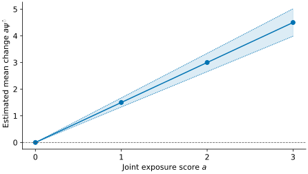

# Continuous outcomes

This small constructed dataset has two exposure scores, `x1` and `x2`, each
in 0–3. `q=None` uses these scores directly. With raw measurements, omit
`q=None` to estimate quartile boundaries from the training data.

```python
--8<-- "docs/examples/gaussian.py"
```

Output (joint-effect row from `summary()`):

```text
Term  Estimate  SE         CI lower  CI upper  t        p-value
psi   1.5       0.0877058  1.3281    1.6719    17.1026  2.70924e-10
```

`psi = 1.5` is the fitted change in the mean outcome when both exposure
scores rise by one. `se` is the standard error; `ci` contains normal
confidence limits. The p-value uses a separate Student t convention.
These illustrative data do not establish coverage or causality.



[Download the Python example](https://github.com/nilson01/quantilemix/blob/main/docs/examples/gaussian.py).
For named columns and categorical adjustment, see [fit_formula](../reference/continuous.md#quantilemix.fit_formula).
