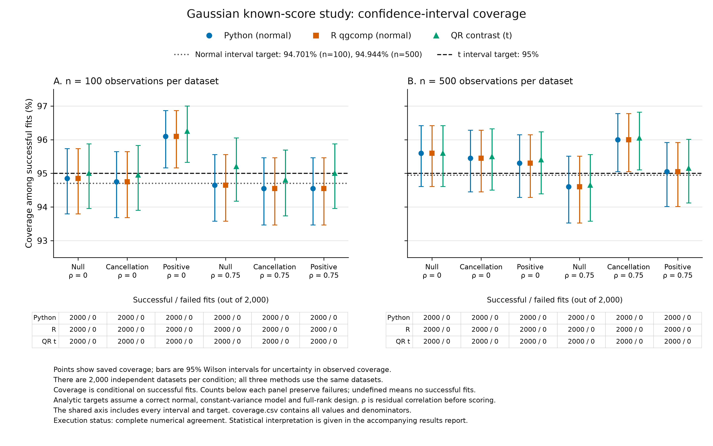

# Gaussian known-score validation results

Protocol: `gaussian-known-scores-v1`.
Study source: `8cb4619934e1cf02ed8ade3b09f09b25115f9381`.

## Main finding

We completed all 24,000 planned datasets across 12 conditions. All 72,000
method fits succeeded without recorded warnings. Python agrees with installed
R qgcomp 2.19.6 within the fixed tolerances on every dataset. Its estimates,
variances and standard errors also agree with the independent QR calculation.
These comparisons support the implemented calculation in the tested setting.

Observed Python/R 95% interval coverage ranges from **94.55% to 96.10%**.
False-positive rates range from **3.95% to 5.40%** across the eight joint-null
conditions. No prespecified descriptive flag is triggered, but two conditions
have coverage above their analytic targets outside the pointwise Wilson
intervals; one also has a false-positive rate below its target. We retain and
explain these departures below. The study supports near-nominal uncertainty
behavior within this narrow design, with finite Monte Carlo precision. It does
not establish exact calibration in every condition or broader model validity.

The [full result record](calibration-study-results.json) contains all 36
method-by-condition summaries, counts, comparisons, environment versions and
evidence hashes. The [protocol](GAUSSIAN_PROTOCOL.md) and
[configuration](calibration-config.json) specify the unchanged design.

## Design and interpretation

We generated independent datasets under a correctly specified additive normal
model with constant error variance, four known exposure scores and two numeric
adjustment variables. Scores use fixed population quartiles, not sample-estimated
quantiles. Sample size is 100 or 500. The parameter rho is residual latent
exposure correlation before scoring, either 0 or 0.75. It is not the correlation
of the scored variables. Each condition has 2,000 datasets.

The target is the sum of the four exposure coefficients: 0 for the null and
cancellation settings, and 0.25 for the positive setting. Cancellation combines
coefficients 0.25 and -0.25. Python, installed R and the QR contrast use the same
retained arrays. The study seed namespace is separate from the earlier 20-case
pilot, which is excluded from these results. No repetitions, tolerances, inputs,
model settings or stopping rules were changed after results were inspected.
The execution was not resumed and no study cases were retried.

Python and R use normal confidence limits and p-value degrees of freedom
n - 5. Their analytic coverage is 94.700655% at n = 100 and 94.943710% at
n = 500. Under a joint null, their analytic rejection rates are 5.006228% and
5.000227%. The QR comparator uses a Student t interval and test with n - 7
degrees of freedom, giving analytic coverage 95% and null rejection 5% under
the stated full-rank normal model. These are different conventions; the study
does not change the Python API to the QR convention.

Coverage means the fraction of intervals containing the known true effect.
A false-positive rate is rejection when that effect is zero; power is rejection
when the effect is 0.25. The intervals around reported rates below are Wilson
95% binomial intervals for Monte Carlo uncertainty. They describe variation
from using 2,000 datasets per condition, not uncertainty for one fitted effect.
They are pointwise intervals, not simultaneous intervals across conditions or
paired tests of differences between methods. Methods share datasets and are
not independent replications of the study.

## Completeness and numerical agreement

Every condition and method has planned = attempted = successful = 2,000,
failed = missing = unattempted = 0. All 24,000 expected case identities, seeds
and retained input hashes were checked. Both pairwise comparisons have
24,000 available pairs, 24,000 agreements and no mismatches. All 24,000 valid
R results have the planned reference degrees of freedom. No infrastructure
failure occurred during the study.

The largest absolute Python/R differences are 1.51e-14 for the effect estimate,
3.47e-15 for its variance, 7.85e-15 for its standard error, 2.53e-14 for a
confidence limit and 1.81e-13 for a p-value. Degrees of freedom agree exactly.
The fixed tolerance is absolute 1e-10 plus relative 1e-8 for estimates and
uncertainty; p-values use absolute 1e-10. Python/QR maximum differences are
1.53e-14 for the estimate, 3.41e-15 for variance and 7.47e-15 for standard error.
The QR interval and p-value are deliberately outside the agreement target.

## Estimation

Bias is the mean estimate minus the true effect. Its Monte Carlo standard
error (MCSE) measures uncertainty in that mean. Empirical SD is the observed
standard deviation across datasets. RMS SE is the square root of the mean
reported variance. These two spread summaries and mean interval width are
descriptive: no uncertainty interval or formal variance-calibration test was
planned for them.

Python and R have identical displayed summaries below; all QR estimation
summaries also match at this precision. Their interval widths differ because
the QR method uses t critical values. The largest absolute bias is 0.00535;
the largest absolute bias divided by its MCSE is 2.12, below the descriptive
three-MCSE flag.

| n | rho | Coefficients | Bias (MCSE) | Empirical SD | RMS SE | Mean width, normal / t |
| ---: | ---: | --- | ---: | ---: | ---: | ---: |
| 100 | 0 | null | 0.00446 (0.00457) | 0.20433 | 0.20320 | 0.79261 / 0.80306 |
| 100 | 0 | cancellation | 0.00172 (0.00464) | 0.20754 | 0.20368 | 0.79425 / 0.80472 |
| 100 | 0 | positive | -0.00423 (0.00430) | 0.19246 | 0.20347 | 0.79363 / 0.80409 |
| 100 | 0.75 | null | -0.00535 (0.00258) | 0.11532 | 0.11661 | 0.45518 / 0.46118 |
| 100 | 0.75 | cancellation | -0.00038 (0.00259) | 0.11605 | 0.11612 | 0.45323 / 0.45920 |
| 100 | 0.75 | positive | -0.00043 (0.00261) | 0.11688 | 0.11646 | 0.45450 / 0.46049 |
| 500 | 0 | null | -0.00027 (0.00191) | 0.08556 | 0.08843 | 0.34630 / 0.34715 |
| 500 | 0 | cancellation | 0.00188 (0.00196) | 0.08785 | 0.08835 | 0.34600 / 0.34685 |
| 500 | 0 | positive | 0.00418 (0.00198) | 0.08839 | 0.08853 | 0.34670 / 0.34756 |
| 500 | 0.75 | null | 0.00001 (0.00116) | 0.05207 | 0.05087 | 0.19925 / 0.19974 |
| 500 | 0.75 | cancellation | -0.00003 (0.00110) | 0.04912 | 0.05087 | 0.19923 / 0.19972 |
| 500 | 0.75 | positive | -0.00141 (0.00114) | 0.05087 | 0.05087 | 0.19923 / 0.19972 |

## Coverage

Each rate uses 2,000 successful fits. Because there are no failed or missing
fits, the success-conditional rate equals covered/planned, and both endpoints
of the all-planned coverage bound equal that rate. The JSON and CSV retain
these denominators explicitly. Python and R coverage counts are identical.

| n | rho | Coefficients | Python/R covered | Coverage % [95% interval] | QR t covered | Coverage % [95% interval] |
| ---: | ---: | --- | ---: | --- | ---: | --- |
| 100 | 0 | null | 1897 | 94.85 [93.79, 95.74] | 1900 | 95.00 [93.96, 95.87] |
| 100 | 0 | cancellation | 1895 | 94.75 [93.68, 95.64] | 1899 | 94.95 [93.90, 95.83] |
| 100 | 0 | positive | 1922 | 96.10 [95.16, 96.86] | 1925 | 96.25 [95.32, 97.00] |
| 100 | 0.75 | null | 1893 | 94.65 [93.58, 95.55] | 1904 | 95.20 [94.17, 96.05] |
| 100 | 0.75 | cancellation | 1891 | 94.55 [93.47, 95.46] | 1896 | 94.80 [93.74, 95.69] |
| 100 | 0.75 | positive | 1891 | 94.55 [93.47, 95.46] | 1900 | 95.00 [93.96, 95.87] |
| 500 | 0 | null | 1912 | 95.60 [94.61, 96.41] | 1912 | 95.60 [94.61, 96.41] |
| 500 | 0 | cancellation | 1909 | 95.45 [94.45, 96.28] | 1910 | 95.50 [94.50, 96.32] |
| 500 | 0 | positive | 1906 | 95.30 [94.28, 96.14] | 1908 | 95.40 [94.39, 96.23] |
| 500 | 0.75 | null | 1892 | 94.60 [93.52, 95.51] | 1893 | 94.65 [93.58, 95.55] |
| 500 | 0.75 | cancellation | 1920 | 96.00 [95.05, 96.77] | 1921 | 96.05 [95.10, 96.82] |
| 500 | 0.75 | positive | 1901 | 95.05 [94.01, 95.92] | 1903 | 95.15 [94.12, 96.01] |

The figure shows all conditions on a common percentage scale. Bars are Wilson
95% intervals. Each method has 2,000 successful fits and zero failures per
condition. See the [vector figure](figures/gaussian-known-scores-v1/coverage.pdf),
[underlying table](figures/gaussian-known-scores-v1/coverage.csv) and
[figure provenance](figures/gaussian-known-scores-v1/provenance.json).

## False-positive rates and power

All denominators are 2,000. Python and R rejection counts are identical. QR
rejects one fewer dataset in the n = 500, rho = 0.75 null condition because
its test uses different degrees of freedom; all other rejection counts agree.

| n | rho | Coefficients | Meaning | Python/R rejected | Rate % [95% interval] | QR t rejected | Rate % [95% interval] |
| ---: | ---: | --- | --- | ---: | --- | ---: | --- |
| 100 | 0 | null | false positive | 100 | 5.00 [4.13, 6.04] | 100 | 5.00 [4.13, 6.04] |
| 100 | 0 | cancellation | false positive | 101 | 5.05 [4.17, 6.10] | 101 | 5.05 [4.17, 6.10] |
| 100 | 0 | positive | power | 414 | 20.70 [18.98, 22.53] | 414 | 20.70 [18.98, 22.53] |
| 100 | 0.75 | null | false positive | 96 | 4.80 [3.95, 5.83] | 96 | 4.80 [3.95, 5.83] |
| 100 | 0.75 | cancellation | false positive | 104 | 5.20 [4.31, 6.26] | 104 | 5.20 [4.31, 6.26] |
| 100 | 0.75 | positive | power | 1137 | 56.85 [54.67, 59.01] | 1137 | 56.85 [54.67, 59.01] |
| 500 | 0 | null | false positive | 88 | 4.40 [3.59, 5.39] | 88 | 4.40 [3.59, 5.39] |
| 500 | 0 | cancellation | false positive | 90 | 4.50 [3.68, 5.50] | 90 | 4.50 [3.68, 5.50] |
| 500 | 0 | positive | power | 1637 | 81.85 [80.10, 83.48] | 1637 | 81.85 [80.10, 83.48] |
| 500 | 0.75 | null | false positive | 108 | 5.40 [4.49, 6.48] | 107 | 5.35 [4.45, 6.42] |
| 500 | 0.75 | cancellation | false positive | 79 | 3.95 [3.18, 4.90] | 79 | 3.95 [3.18, 4.90] |
| 500 | 0.75 | positive | power | 1995 | 99.75 [99.42, 99.89] | 1995 | 99.75 [99.42, 99.89] |

## Departures from the analytic targets

Two conditions require explicit qualification. At n = 100, rho = 0, positive
coefficients, Python/R coverage is 96.10% [95.16%, 96.86%], above the analytic
94.700655%. QR coverage is also high: 96.25% [95.32%, 97.00%], above its 95%
target. In this condition empirical SD is 0.19246 and RMS SE is 0.20347.
These observed spread summaries accompany the higher coverage; they do not
identify its cause through a separately planned variance-calibration test.

At n = 500, rho = 0.75, cancellation coefficients, Python/R coverage is 96.00%
[95.05%, 96.77%], above 94.943710%; QR coverage is 96.05% [95.10%, 96.82%].
The false-positive rate is 3.95% [3.18%, 4.90%] for all methods, below their
approximately 5% analytic targets. This departure means fewer false positives
in this particular simulated condition; it is not evidence of general
superiority or a reason to change the estimator.

These intervals are pointwise across multiple conditions. They do not promise
that every analytic target lies inside every realized interval. The common
pattern in Python, R and the independent QR contrast is consistent with finite
Monte Carlo variation, but agreement cannot prove that explanation or rule out
all shared implementation issues. The saved-record audit found no missing
cases, fitting failures or numerical mismatches. The prespecified coverage
flag asks whether a Wilson interval lies wholly outside [93%, 97%]; neither
condition meets that broader descriptive criterion. We report both departures
without adding replicates, changing tolerances or treating the absence of a
flag as proof of calibration.

## Execution, environment and verification

The study ran once on an x86-64 Linux server through Slurm, with one numerical
worker and thread, a one-CPU request, two allocated logical CPUs, 16 GiB of
memory and a two-hour limit. Scheduler elapsed time was 1h 18m 55s. The runner
recorded 4,708.66 seconds through summary writing, including 4,611.93 seconds
for generation/fitting/checkpoints and 93.65 seconds for final aggregation.
The narrower runner time excludes its final timing-file write and lock release.

The kernel-observed batch-cgroup peak was 3,031,068,672 bytes (2.823 GiB).
The two-second samples peaked at 3,030,126,592 bytes, with a maximum observed
sample gap of 2.35 seconds. Cgroup usage includes descendants and charged page
cache; it is not process RSS. All 2,355 samples remained below the 14 GiB guard.
The 16 rounded scratch-quota observations had at least 25 GiB headroom, above
the 10 GiB stop threshold. These observations do not reserve shared storage.
Owned processes stopped and the writer lock was removed. The completed run
contains 1,203 files and 535,384,830 bytes (510.58 MiB), below the 3 GB ceiling.

The study used Python 3.11.5, NumPy 2.0.0, SciPy 1.14.0, R 4.5.2 and qgcomp
2.19.6. The record includes actual package versions, installed-file identity
hashes, 25 downloaded R archive hashes and native toolchain versions. Before
the study, the isolated server environment passed 316 deterministic tests,
all nine installed-R fixed cases and an empty adapter identity check.
This is a newly recorded Linux environment, not exact restoration of the Mac
pilot. Initial module package copies and later source builds were retained in
the private installation record. Upstream module build archives are unavailable;
this is not a fully locked transitive build.

Two installation attempts failed before the successful setup: CRAN package-index
retrieval failed for an unresolved transient reason, then missing CMake prevented
nloptr and its dependent R packages from building. A fresh installation with
an existing matching CMake module passed. During result verification, the first
read-only job passed the independent record check but stopped because external
`/usr/bin/time` was absent. Replacing that measurement wrapper with Bash built-in
timing allowed the same checks to finish. No study datasets or fits were repeated.
All failed attempts remain preserved in the private execution record.

The independent checker streamed all retained batches and recomputed counts,
comparisons and summaries without fitting models, drawing data or starting R.
Production read-only reaggregation reproduced every summary field exactly,
apart from the expected directory-size change after summary/timing writes.
Every returned file matched the separately retained server SHA-256 and size
inventory. The local independent check also passed. Its Wilson endpoints
occasionally differ from the server check by at most 1.11e-16; all other fields
except the checker file hash agree exactly. These differences are below the
existing summary reconciliation tolerances; no tolerance was changed.

The checks establish integrity and arithmetic agreement of retained evidence.
They do not independently prove how R parsed every input value or that the
pseudorandom streams are independent. The QR implementation also shares
NumPy/SciPy with the Python package. These limits remain distinct from the
statistical assumptions behind the analytic benchmarks.

## Reproduce and use the evidence

Use the [runner instructions](../docs/development.md#gaussian-calibration-runner)
and [installed-R instructions](../docs/reference.md#installed-r-gaussian-check).
The source revision, configuration, actual dependencies and checksums are in
[the result record](calibration-study-results.json). A replay needs a new output directory. Equal seeds alone do not promise
identical data under different numerical dependencies.

The optional standard-library checker can validate a retained complete run.
The optional figure script regenerates the figure from the result JSON with
Matplotlib, Pillow and pypdf in a separate authoring environment. These tools
add no R or plotting dependency to the Python model API. Raw generated inputs,
logs, environment inventories and failed attempts remain in the project's
private validation storage; this compact repository record does not include
all raw inputs. It is therefore not a self-contained raw-data archive.

The runner and checker deliberately retain `calibration_validated: false`:
this means they issue no automatic calibration certificate. The qualified
interpretation is this report. This study does not assess estimated quantiles,
misspecification, weights, missing data, nonlinear effects, other families,
dependent rows or causal identification. It is not a reproduction of all
settings in the original paper, which used qgcomp 1.3. The prequantized R
prediction-wrapper limitation remains unchanged and does not affect these fits.

## Credit and review scope

The estimator and coefficient-sum interpretation follow
[Keil et al. (2020)](https://doi.org/10.1289/EHP5838) and Alexander Keil's
[R qgcomp](https://github.com/alexpkeil1/qgcomp). The design and reporting use
[Morris, White and Crowther (2019)](https://doi.org/10.1002/sim.8086).
